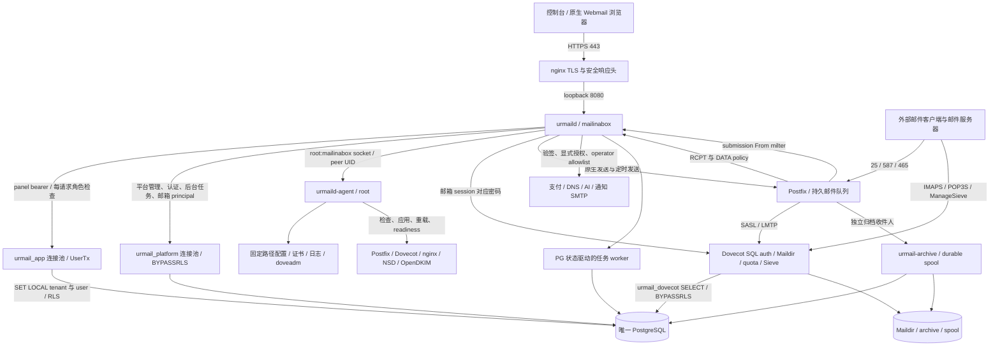

# urMail 本地源码安全审查与工程质量评估

> 本文保留初始审查时点的发现与结论。后续修复、主分支 CI 与受控生产部署结果见 [SECURITY_REMEDIATION_RESULT.md](SECURITY_REMEDIATION_RESULT.md) 第 11 节。

审查日期：2026-10-26（Asia/Shanghai）  
审查方式：只读、非侵入式防御性源码审查  
仓库：`github.com/bushixiucai/urmail`  
初始提交：`ff16a577659f0aa21e30118df04f4dbef1c08b61`  
最终复核提交：`3322bbf26805dcb17f7289e602bebe4d0771b204`（业务源码复核于 `beed798f429e2eae485b45fe0f5bfed8e48428c2`）  
应用版本文件：`VERSION:1`，`0.4.1-rc.2`

本报告仅新增研究文档，不修改业务源码、数据库、服务或配置，不执行安装、漏洞利用、扫描、线上请求、实付款、Git 提交或推送。外部访问仅用于查阅第三方官方安全公告，未上传项目源码或凭据。

审查过程中有其他写入者修改并提交了 milter/Postfix 代码，HEAD 先变为 `beed798f`，交付复核时又出现仅修改 `scripts/test-release-installer.py` 的 `3322bbf2`；已阅读后一个提交范围并静态解析该 Python 文件语法，业务源码与 beed798f 一致；本审查及审查子代理均未执行这些修改或提交。已重新读取相关文件，以最终提交的解析器、milter 接入与配置为结论依据，不再报告已修复的列表空格及消息状态隔离问题。开始和结束时均存在未跟踪的 `.impeccable/`、`scripts/w13/__pycache__/`，不属于本报告改动。并行活动意味着这不是整个工作区的原子快照；后续新提交需要复审。

## 1. Executive Summary — 执行摘要

**发布结论：BLOCKED。** 阻断依据是 SEC-01：公共面板登录将接近 HTTP 请求体上限的未认证密码输入直接交给具有平方级输入处理成本的 SHA512-CRYPT 实现，同步计算不受请求 context 取消控制。长度边界缺失及算法处理量均有源码依据；未进行负载测试，不宣称已实测服务宕机。建议首先封闭这一输入边界，再处置其他问题并进行另行授权的隔离环境验证。

共记录 **9 项：P0 0 项、P1 1 项、P2 7 项、P3 1 项**。没有在已审调用链中确认跨租户数据读写、任意 root 命令执行、支付验签绕过或直接资金越权。该表述只描述本次审查结果，不构成这些类别不存在漏洞的保证。

| 编号 | 等级 | 主要问题 | 证据状态 |
|---|---|---|---|
| SEC-01 | P1 | 公共登录缺少密码长度上限，触发平方级密码处理成本 | 输入流与复杂度已由源码证实；实际容量影响未动态验证 |
| SEC-02 | P2 | 面板改密与其他会话撤销非原子，认证中间状态未绑定凭据版本 | 源码证实；故障及并发窗口未动态验证 |
| SEC-03 | P2 | 主密钥加载失败后继续运行，新增 TOTP 种子可退回明文入库 | 源码证实的配置故障降级路径；生产是否触发未知 |
| SEC-04 | P2 | MFA challenge 和 Webmail 密码内存状态缺少到期回收及容量边界 | 源码证实；未测内存耗尽 |
| SEC-05 | P2 | 未验签支付回调完整落库，缺少持久存储预算与清理 | 源码证实；实际磁盘影响未验证 |
| SEC-06 | P2 | 最早不可执行退款使其他租户的正常退款无法自动派发 | 源码证实的队首阻塞路径 |
| SEC-07 | P2 | SMTP、归档和 HTTP 导出的大小契约不一致 | 源码证实；队列最终处置需环境验证 |
| SEC-08 | P2 | From 授权用字符串截取替代邮件地址解析，未检查字段内全部地址 | 解析缺口源码证实；收件端影响未动态验证 |
| SEC-09 | P3 | 生产 HTTP 监听地址未强制 loopback，允许配置偏离 TLS 代理边界 | 一般加固建议；默认安全，生产状态未知 |

项目具有实质性安全控制：事务级 RLS 上下文、复合租户外键、逐请求角色检查、独立邮箱身份、显式归档内容授权、typed root agent、配置应用日志与恢复、支付验签及持久幂等、SMTP 不确定结果处理、DNS 计划 fencing、邮件 HTML 沙箱及发布清单签名。不能根据旧 README 推导“仍依赖 Roundcube/Nextcloud”或“商业模块未实现”。

最大证据缺口包括：当前生产包与源码是否一致、实际数据库角色与迁移、服务配置和文件权限、系统组件补丁、备份恢复、支付真实商户行为及公网 ACME。纯静态审查不覆盖这些事实。

### 1.1 证据口径与实际执行

- **已由源码证实**：给出可追踪的实现或确定性控制流；不等于已验证生产可利用。
- **合理风险但未动态验证**：代码缺口明确，但服务容量、其他解析器行为或故障频率尚不确定。
- **配置或部署信息不足**：仓库只给模板/默认值，未读取宿主机或生产状态。
- **一般性安全加固建议**：改进防误配、运维或密码策略，不认定现有默认部署已经失守。

实际执行：文件清单、`rg`、带行号源码阅读、迁移和 SQL 串联、Git 状态/历史/差异检查、锁文件解析；离线 `GOTOOLCHAIN=local GOPROXY=off GOSUMDB=off go vet ./...` 通过，在 beed798f 业务源码复跑通过；`web/node_modules/.bin/tsc -p web/tsconfig.json --noEmit --incremental false` 通过；installer/packaging/scripts 下 4 个 `.sh` 文件的 `bash -n` 全部通过；交付时 `scripts/test-release-installer.py` 的 Python AST 语法解析通过，未运行该脚本。首次 TypeScript 命令引用不存在的 `tsconfig.app.json` 返回 TS5058，改为实际配置后通过。未运行 `make build`、测试套件、数据库集成测试、浏览器或邮件协议测试，也未启动服务。

已阅读现有测试及验收摘要。`docs/reviews/evidence/m1-m7-2026-10-24/verification-summary.md` 同时记有当时的通过和失败；`docs/acceptance/native-webmail-remediation-2026-10-26.md`、`native-webmail-deployment-2026-10-26.md` 记有后续本地、远端 CI 和部署结果。这些记录绑定历史提交，不能替代最终提交的本次执行证据，不能把历史线上验证授权延伸到本次任务。

## 2. Actual Architecture — 实际架构

### 2.1 组件与版本

| 组件 | 当前实现/版本依据 | 主要源码路径及安全边界 |
|---|---|---|
| 后端 | Go 1.27.3；Gin 1.12.0；zap 1.28.0 | `go.mod`；`cmd/urmaild/main.go`；`internal/api/router.go` |
| 数据库 | PostgreSQL；pgx/v5 5.11.0；sqlc 生成查询；golang-migrate 4.20.1 | `internal/db/`、`internal/store/queries/`、`sqlc.yaml`、`migrations/`；无业务 ORM |
| 数据库版本 | 开发/CI 服务声明 PG16；生产 AP      T 包版本未锁定 | `docker-compose.dev.yml`、`.github/workflows/ci.yaml`、`installer/install.sh`；不能据此声称生产为 PG16 |
| 数据库 schema | 连续 up/down 迁移至 0079 | `migrations/0079_alias_cycle_preflight.*.sql`；实际已应用版本未知 |
| 控制台/原生 Webmail | React/React DOM 19.3.1、React Router 7.18.4、TypeScript 5.9.3、Vite 6.4.5、Tailwind/shadcn 风格组件 | `web/package-lock.json`、`web/src/`；Go embed 提供静态资源，生产无 Node SSR |
| SMTP/队列 | 系统 Postfix；生成器 compatibility level 3.6，并非软件版本锁 | `internal/mail/postfix/`、`internal/mail/policy/`；25、587、465；Postfix 自带持久队列 |
| 邮件访问/存储 | 系统 Dovecot；IMAP、POP3、LMTP、ManageSieve；SQL passdb/userdb；Maildir | `internal/mail/dovecot/`、`packaging/dovecot/99-urmail.conf`；账号和配额来自同一 PG |
| Webmail 协议客户端 | 自建 Go IMAP/SMTP/MIME 客户端 | `internal/webmail/`、`internal/api/handlers/mailbox_native*.go`；独立 mailbox bearer 和进程内密码 vault |
| 发件授权 | Postfix sender_login map + SaaS policy + 新增 From milter | `internal/mail/frombind/`、`internal/mail/frommilter/`；milter `127.0.0.1:12302` |
| DKIM/反垃圾 | OpenDKIM；v80 preserve profile 可保留 OpenDMARC、spampd、旧 greylist/RBL 链 | `internal/mail/postfix/maincf.go`、`internal/mail/dkim/`；新装不等于完整旧反垃圾栈 |
| DNS | NSD 权威区域生成；Cloudflare、DNSPod、Aliyun API 适配 | `internal/mail/nsd/`、`internal/dnsprovider/`、`internal/onboarding/` |
| TLS | nginx TLS 终止；certbot HTTP-01/CSR；agent 部署证书 | `internal/agentd/certificates.go`、`internal/certs/`、`packaging/nginx/` |
| 特权 helper | Go root `urmaild-agent`，Unix socket typed capabilities | `cmd/urmaild-agent/`、`internal/agentd/`；无任意 shell 接口 |
| 支付/订阅 | Stripe、PayPal、微信、支付宝实际适配器；quote、订单、term、额度、原路退款和商业账单 PDF | `internal/payment/`、`internal/refund/`、`internal/domain/billing/`、`internal/api/handlers/billing*.go`、`internal/pdf/` |
| 后台任务 | Go goroutine/ticker + PG outbox/claim/lease/fence | notify、marketing、refund、onboarding、archive、mailboxschedule、telemetry、reconcile；未发现独立 Redis/RabbitMQ/Kafka |
| AI | OpenAI/Azure 兼容 provider、Ollama；配置、预算、同意和用量账本 | `internal/ai/`、`internal/api/handlers/mailbox_ai*.go`；非任意工具执行 agent |
| 监控 | Prometheus Go client 1.25.0；可选本地 Prometheus/Alertmanager 系统包 | `internal/telemetry/`、`internal/api/middleware/metrics*.go`、`packaging/observability/` |
| 安装/升级 | Ubuntu 22.04/24.04、amd64/arm64；deb、APT、systemd；显式兼容迁移工具 | `installer/install.sh`、`packaging/deb/build.sh`、`cmd/urmailctl/` |
| 构建/发布 | npm ci → tsc/Vite → embed → 4 个 Go 二进制 → deb → Ed25519 签名清单 | `Makefile`、`.github/workflows/ci.yaml`、`package.yaml`、`scripts/release-manifest.py` |

Postfix、Dovecot、nginx、NSD、OpenDKIM、certbot、PostgreSQL 的运行版本由目标 Ubuntu APT 决定，源码没有精确锁定；测试夹具曾使用的版本不是生产版本。所有直接 Go/npm 依赖及锁文件全量 npm 包清单见文末附录。

### 2.2 架构图与真实信任边界



RLS 的权威范围是 **urmail_app 角色的 SQL**，并不包含整个 Go 进程。认证和大量系统任务持有 `urmail_platform` 池，Dovecot 也显式 BYPASSRLS；这些路径依靠调用入口、资源绑定、受限 SQL 与数据库约束保护。整个 urmaild 进程或 platform 凭据被控制后，RLS 不是抵御这一威胁的边界。该设计事实本身不作为漏洞。

### 2.3 已移除、兼容及未实现能力

- Nextcloud/Roundcube schema 分别由 0072/0074 移除，0073/0075 清理其 cluster role（有跨库依赖或权限不足时允许保留历史角色，需核查现场）；bootstrap 不再为新装永久创建这些角色。不能把它们列为当前默认 Webmail 或独立数据库。
- Go 仍保留 `RoundcubeEnabled`、HMAC bridge/Sieve exchange、旧恢复与迁移兼容代码。它们是带开关的兼容面，不表示仓库仍部署完整 Roundcube；是否存在外部旧服务需要环境核实。
- `/admin` legacy API 仍存在，实际为平台管理员兼容 API，不是普通租户接口。
- 未发现 JMAP 服务、自助忘记密码路由、完整共享邮箱产品接口。未实现功能不自动计入漏洞。
- `aggregated`/`tax_invoice` 枚举不等于已实现支付 provider；商业账单 PDF 也不等于正式税务开票集成。相关未实现能力不虚构资金漏洞。
- NSD 区域和 DNS 引导可输出 SPF/DMARC；新装代码没有证明部署了完整入站 SPF/DMARC/病毒扫描栈。v80 保留链需另核对其宿主机组件，不能将历史服务自动归入新装依赖。

## 3. Security Controls Inventory — 已实现控制清单

| 控制面 | 实际控制及调用边界 | 主要证据/局限 |
|---|---|---|
| 注册/验证 | 注册开关、IP 限流、一次性联系邮箱验证、pending 租户、事务落库 | `handlers/registration.go`、0047/0062；异步送达仍依赖通知配置 |
| 面板密码 | 随机 16 字符盐的 SHA512-CRYPT，默认 5000 rounds，固定长度摘要常量时间比较 | `internal/domain/mail/password.go:41`、`:70`；长度边界见 SEC-01，非 memory-hard |
| 面板会话 | 随机 32 字节 token，PG 只存 SHA256，7 天期限，Bearer 认证 | `handlers/auth.go:177`、`middleware/auth.go:30`；改密撤销见 SEC-02 |
| 账号停用/角色撤销 | 会话读取联表检查 active user、active/pending tenant；每请求重新查询 tenant role/platform admin | `queries/auth.sql:32`、`middleware/dbtx.go:81`、`middleware/platform.go` |
| MFA | TOTP、最多 ±1 周期、短期 challenge、三次预算、恢复码 SHA256/SQL 原子消费、token 原子 take | `auth_mfa.go`；种子加密故障与清理见 SEC-03/04 |
| 应用凭据/legacy | 独立 hash、scope、有效期、撤销；平台管理员和 fresh MFA 发放约束；legacy 写请求有额外校验/审计 | `auth_application.go`、`legacy.go`；不复用普通邮箱 bearer |
| 租户身份来源 | 从已验证服务器 session 取 tenant/user，再重查 membership；切换租户检查用户所属关系 | `middleware/auth.go:72`、`auth.go` 的 SwitchTenant、`middleware/dbtx.go` |
| RLS 上下文 | `set_config(..., true)` 仅事务有效，无上下文 NULL/fail closed；错误 rollback/连接归还 | `internal/db/db.go:97`；不得改为 session SET |
| 数据库角色 | app 不拥有表；platform 拥有表并跨租户；Dovecot 只授所需 SELECT/EXECUTE；migrate 负责 DDL | `internal/db/bootstrap.sql`、0003/0004/0008/0011 迁移 |
| 关联完整性 | tenant/domain、mailbox、archive、order item、payment 等复合外键；别名 sender grants、环路/语法限制 | 0007/0013/0018/0069/0078/0079；防止仅改外键 ID 跨租户引用 |
| SQL 与数据库函数 | sqlc 参数化；平台查询显式命名；SECURITY DEFINER 固定 owner/search_path、撤销 PUBLIC 并做 scoped 检查 | `internal/store/queries/`、0035 等；pg_catalog/public 的 CREATE 权限由 bootstrap 收紧 |
| 事务与审计 | 租户变更 advisory lock；响应缓冲；成功审计同事务；失败独立审计；AfterCommit 执行副作用 | `middleware/dbtx.go`、`platform_dbtx.go`、`audit*.go`；大响应见 SEC-07 |
| 归档内容权限 | owner/admin 还需要显式 compliance grant；正文/export 独立 scope；路径归属与 SHA256 校验后审计 | `archive_content.go:29`、`:53`、`:90`；平台管理身份不自动拥有 mailbox 内容权 |
| 邮箱身份 | 独立 mailbox session，检查 tenant/domain/mailbox 状态、password_version、有效期；HTTP 不消费 panel session | `queries/platform_mailbox_principal.sql`、`middleware/mailbox_auth.go` |
| 邮件权限撤销 | 改密版本及 revoke_pending；agent 定期核对并对精确邮箱执行 doveadm kick，失败重试 | 0067、`internal/agentd/mail_access.go`；现有连接撤销延迟需环境验证 |
| SMTP 身份/反滥用 | 25 禁 AUTH；587 强制 STARTTLS、465 隐式 TLS；envelope sender_login 精确绑定；RCPT/DATA 检查订阅和日发送量 | `mail/postfix/{maincf,mastercf,maps}.go`、`mail/policy/`；From 检查见 SEC-08 |
| 邮件存储与配额 | Dovecot active 联表、domain ready、Maildir、quota/ACL、LMTP quota；保存稳定存储身份避免地址复用 | `mail/dovecot/render.go`、0023/0024；无独立对象存储服务 |
| Webmail 内容隔离 | HTML 清理、邮件 iframe `sandbox=""`、srcDoc 独立 CSP、no-referrer、远程资源限制 | `web/src/features/webmail/sanitize-html-mail.ts`、`mailbox-inbox-page.tsx:1003`；未发现可据此直接断言的 XSS |
| 附件与 MIME | 显式下载、octet-stream、nosniff、no-store、安全文件名；MIME 深度/数量/大小限制 | `mailbox_native_messages.go:95`、`webmail/mime_parts.go`；非任意服务端文件路径 |
| HTTP 输入 | 1 MiB 默认请求体；发送/草稿 16 MiB；30 秒 context；server 10/60/120 秒读写/空闲预算 | `router.go:129`、`bodylimit.go`、`cmd/urmaild/main.go:280`；context 不会抢占同步 CPU 计算 |
| CSRF/CORS | panel 变更要 session CSRF，检查 Origin/Referer host；主认证采用显式 Bearer；未发现通配开放 CORS | `middleware/csrf.go`；缺少 Origin 不直接豁免 CSRF token |
| Sieve 兼容 Cookie | host-only、限定 path、HttpOnly、SameSite Strict；HTTPS 时 Secure；ticket 单次交换及同源检查 | `handlers/sieve_bridge.go:53–108`；仅 loopback 开发允许 HTTP；主控制台和原生邮箱用 Bearer |
| TLS/响应头 | nginx HSTS、CSP、frame deny、nosniff；TLS≥1.2；proxy 覆盖 XFF，Go 只信 loopback proxy | `packaging/nginx/urmail.conf`、`urmail-ssl.conf`；模板与现场部署须区分 |
| 敏感数据加密 | AES-256-GCM、随机 nonce、enc:v1；DNS/商户凭据只写不回显 | `internal/secrets/box.go`；TOTP fallback 见 SEC-03；密钥轮换不是单改 master.key |
| SSRF/模型外发 | operator endpoint 精确白名单，云授权、DNS pinning、拒绝 reserved IP、禁止默认 redirect/环境代理、输入预算 | `internal/ai/{configured,openai}.go`、`mailbox_ai.go`；不是任意租户 URL 直接出网 |
| 支付/商业授权 | 服务端定价和签名 quote，角色/快照/优惠券核对；provider 验签、金额币种商户绑定、事件 hash/事务幂等、异常人工审核 | `payment/registry.go`、`payment_registry.go`、`billing_authority.go`、`order_settle.go` |
| 退款/权益 | 审批与持久 processing 先于物理退款；未知结果只查询核对；按批准 term 撤权并事务更新账单/佣金 | `refund/service.go`；派发公平性见 SEC-06 |
| 任务可靠性 | PG claim/lease/CAS；schedule 使用 UIDVALIDITY、幂等 key、取消边界；接受后先记 sent，未知提交进入 uncertain | `mailboxschedule/worker.go`、0076/0077；sent 不代表外部收件完成 |
| root agent | 生产 registry 仅 typed operations；Unix peer UID、0660 socket、32 slots、请求上限与超时 | `agentd/protocol.go:138`、`server.go`、`peercred_linux.go`；旧 WriteFile/PostconfSet 未注册 |
| 配置/DNS/证书 | 纯生成器、journal、atomic write/fsync、语法检查、失败恢复；DNS plan 摘要/version/fence/确认；证书 hostname/链/key 复验 | `agentd/apply.go`、`certificates.go`、`onboarding/dns_worker.go` |
| 日志/监控 | 结构化日志字段 denylist；访问日志不记录 query/body；指标使用 bounded labels；metrics 本机 token 或平台管理员 | `logging/logger.go`、`middleware/middleware.go`、`metrics*.go`；自由文本错误仍需持续审计 |
| 备份/恢复 | root 私有目录，数据库 peer dump；完整邮件备份要求停写；恢复 quarantine/hold 防资金和邮件任务重放 | `cmd/urmailctl/backup*.go`、`restore*.go`、`internal/db/restore_quarantine.go` |
| 发布完整性 | go.sum/npm integrity；远程清单 pinned Ed25519 公钥验签再验 SHA256；发布 Actions SHA 固定 | `installer/install.sh:79`、`package.yaml`；CI 通用 workflow 部分 actions 仍用 tag |

### 3.1 数据资源与授权边界复核

| 数据资源 | 当前授权与数据约束 | 复核结论/剩余边界 |
|---|---|---|
| tenants/users/roles/sessions | app 写权限已在 0008 撤销，sessions 对 app 撤全部 CRUD；平台认证处理；每请求 membership | 不能按 0001 的历史宽策略认定现存写越权；SEC-02 是撤销一致性问题 |
| domains/mailboxes/aliases | tenant 谓词 + RLS；domain 复合外键；验证 challenge 原子匹配；sender grants 与 target 语法/环路限制 | 未确认跨租户 domain ID 注入；外部转发目标属于产品能力，不能仅因外域目标就报泄露 |
| archive/attachments/retention | tenant/mailbox 归属、内容 grant、hold、审计和固定根目录完整性校验 | 明确发现的是容量契约 SEC-07，未确认路径穿越或绕过 grant |
| invoices/orders/subscriptions/payments | tenant scoped reads、平台支付写；复合引用；签名报价及商户 scope；退款/到账 hold | 未确认普通 billing 角色可直接伪造付费到账；SEC-05/06 属资源与业务可用性 |
| DNS credentials/plans | tenant domain ownership、角色、先 preflight 后事务复验；加密 secret、计划 fence/摘要 | 解绑/版本变化不是只凭首次授权继续执行；实际 provider 权限范围未知 |
| mailbox sessions/scheduled sends/AI | 服务端解析邮箱 principal、tenant/mailbox 绑定及版本，引用实际消息或已保存草稿；worker 重新授权 | 管理员配置 AI 不授予邮箱正文读取；过期内存凭据见 SEC-04 |
| settings/brands/content/support | public DTO/白名单读取；租户与平台写入口分开；工单/内容域权限及数据库约束 | 未依据“配置中有 JSON”直接认定代码执行或 SQL 注入 |

RLS 并非一律 FORCE：应用角色非 owner，平台 owner/BYPASSRLS 的可见性是有意保留。没有把“缺少 FORCE ROW LEVEL SECURITY”单独报为漏洞。真实数据库若给 app 额外超级用户/BYPASSRLS/角色成员资格，将破坏这些假设，属于发布前必核项目。

## 4. Security Findings — 具体发现

### SEC-01 — 公共登录密码长度未受限，密码算法存在平方级处理成本

- **严重程度：P1；组件：公共面板认证、共享密码库、控制面可用性。**
- **证据状态：输入可达性及算法复杂度已由源码证实；CPU 时间、服务容量和故障表现未动态验证。**
- **文件与行号：** `internal/api/handlers/auth.go:88–90,135–147`；`internal/api/router.go:129`；`internal/domain/mail/password.go:70–109`；`internal/api/middleware/middleware.go:89–101`；锁定依赖 `github.com/GehirnInc/crypt@v0.0.0-20230320061759-8cc1b52080c5/sha512_crypt/sha512_crypt.go:90–96`（本机 Go module cache 已核读）。
- **描述及调用链：** `POST /api/v1/auth/login` → JSON password 只有 required → 已知用户正常 hash 或未知用户 dummy hash → `VerifyPassword` → SHA512-CRYPT `Generate`。依赖构造 seqP 时执行以下逻辑：

```go
for i := 0; i < keyLen; i++ {
    h.Write(key)
}
```

- **产生条件：** 无需存在账号，也无需认证成功；请求通过 1 MiB 通用 body 限制即可进入密码运算。长度为 n 字节时，上述部分独自处理 n² 字节；接近 1 MiB 的密码对应接近 1 TiB 的累计哈希输入处理量。这是复杂度推导，不是内存分配量或实测耗时。
- **可能影响：** 公共认证请求可以造成远高于正文大小的 CPU 工作。所有请求和 SaaS policy 等运行在同一 urmaild，可能影响控制台和邮件提交可用性。30 秒 context 只通知协作式取消，纯同步哈希不读取 context，不能中断这段计算。
- **已有防护：** body 上限；账号/IP 失败限流；未知用户 dummy hash 避免账号枚举；常量时间摘要比较。限流在计算前检查历史失败，当前计算结束后才记失败，不能替代长度/并发预算。
- **最小修复：** 在校验前对密码字节长度统一设上限并拒绝，不能截断；与现有注册/改密 256 边界协调，处理历史长密码兼容。共享 HashPassword/VerifyPassword 也设防御性边界；邮箱创建/管理重置目前只有 min=6，同步补 max。给公共 hash 操作增加有界并发/请求预算。
- **建议回归：** 注入 hash 调用计数器确认超长输入在哈希前拒绝；未知用户路径同样拒绝；验证 UTF-8 字节边界、正常历史凭据及取消行为。无需在回归中运行危险大输入哈希。
- **尚需验证：** 修复后隔离环境中的合理负载、代理认证限流与进程资源预算。本次没有实施 DoS 或构造线上请求。

### SEC-02 — 面板密码更新和会话撤销缺少统一事务及凭据版本

- **严重程度：P2；组件：面板认证、会话及 MFA 登录中间状态。**
- **证据状态：已由源码证实；故障、并发登录及 MFA 轮换窗口未动态验证。**
- **文件与行号：** `internal/api/handlers/auth_password.go:50–71`；`internal/store/queries/auth.sql:37–43,90–94`；`internal/api/router.go:411–425`；`internal/api/handlers/auth_mfa.go:40–44,374–416`。
- **描述及调用链：** `/auth/password` → 直接连接 platform pool 的 AuthHandler → `UpdateUserPassword` 独立提交 → `DeleteOtherUserSessions` 独立提交。路由没有事务中间件；会话查询不比对 password_changed_at/credential version。
- **产生条件：** 密码 SQL 成功后，撤销 SQL 因请求取消、连接故障或进程退出未完成。另一个已通过旧密码的并发登录可能在清理后才创建 session；pending MFA 只持有 user ID/到期时间，不绑定首因子凭据版本。
- **可能影响：** 密码已经变化，其他旧会话仍可继续使用至删除/停用/7 天到期。已签发的 MFA challenge 也不会因改密自动作废，其剩余有效期最多 5 分钟；仍需正确第二因子，不能称为绕过 MFA。
- **已有防护：** 当前密码校验、CSRF、正常路径撤销其他 session；停用检查；MFA challenge 单次消费；邮箱密码另有 durable password_version，不能把面板缺陷扩大到该实现。
- **最小修复：** 密码更新、保留当前 session 的版本更新及撤销同事务；登录发放与密码轮换共用用户行锁或 credential version，challenge 保存并复验该版本。使用既有 PostgreSQL 即可。
- **建议回归：** 撤销失败时整体回滚；取消/进程中断边界；登录与改密并发；旧 pending MFA 在改密后拒绝；保留的当前 session 仍符合明确策略。现有 `auth_mfa_test.go:538` 正常路径测试不足以证明上述性质。
- **尚需验证：** 真实 PG 故障注入和并发语义；当前是否存在未失效旧会话未知。

### SEC-03 — 主密钥不可用时 TOTP 新种子退回明文存储

- **严重程度：P2；组件：密钥管理、MFA 静态数据保护。**
- **证据状态：已由源码证实的故障降级路径；生产触发状态未知。**
- **文件与行号：** `cmd/urmaild/main.go:117–124`；`internal/api/handlers/auth_mfa.go:179–190`；`internal/api/handlers/auth.go:80–84`；`internal/secrets/box.go`。
- **描述及调用链：** 服务加载 master.key 失败仅 Warn，secretBox 保持 nil；`api.New` 将其交给 AuthHandler；`MFASetup` 仅在 Secrets 非 nil 时加密，否则原始 `key.Secret()` 写入 users.mfa_secret。读取也兼容旧明文。
- **产生条件：** 生产主密钥丢失、内容损坏、读取权限错误或路径错误，且服务继续运行并有用户设置 MFA。无需假定攻击者能修改 root 文件。
- **可能影响：** 新 TOTP 种子进入数据库、WAL 和备份的明文副本，削弱独立第二因子密钥保护；既有加密数据可能不可解密，表现不等于正常安全降级。不能据此声称所有支付/DNS 凭据都退回明文：这些模块还存在自己的 nil 检查及 enc:v1 要求。
- **已有防护：** 正常安装生成 key，root:mailinabox 0640；正常路径 AES-GCM；启动有警告；部分敏感功能 fail closed。
- **最小修复：** 非开发模式启动时强制有效 secretBox，或至少禁用所有新增/更新 secret 操作并进入明确 degraded 状态；legacy 明文读取只能作为可审计迁移能力，不能默认允许新明文写入。
- **建议回归：** 缺失、损坏、不可读 key 下生产启动/写 secret 拒绝；旧明文可显式迁移且新写始终 enc:v1；正常加密种子可验证；不泄露原种子。
- **尚需验证：** 生产 key owner/mode、备份保护、历史明文行数量及轮换流程，均不得从模板推断。

### SEC-04 — 认证临时状态及邮箱明文密码缺少主动回收与容量边界

- **严重程度：P2；组件：MFA challenge、原生 Webmail credential vault。**
- **证据状态：无界保留路径已由源码证实；容量耗尽及内存泄露后果未动态验证。**
- **文件与行号：** `internal/api/handlers/auth_mfa.go:51–106`；`internal/api/handlers/auth.go:155–166`；`internal/webmail/session.go:36–76`；`internal/api/handlers/mailbox_native.go:193–212,297–305`；`mailbox_native_password.go:117–119`；`internal/api/middleware/mailbox_auth.go`。
- **描述及调用链：** MFA 首因子成功每次 issue 新 map 项，只在使用该 token 时按需删除；从不使用的过期 token 无定时清理。Webmail 登录将原密码放进 `byID map[string]string`，Put 不接受 expiry；自然到期、数据库撤销或另一个会话改密不会统一清除此邮箱所有条目，显式登出/当前改密只删除当前 hash。
- **产生条件：** 正常用户关闭页面、反复放弃 MFA 或会话自然到期即可积累；持有合法账号可持续产生条目。MFA 首因子成功不消耗失败预算，Webmail 登录虽有 20/min/IP 请求预算，但没有总容量和历史清理边界。
- **可能影响：** 长期运行 map 持续增长；不再有效会话对应的原始密码仍留在内存，扩大内存转储/进程受控时的暴露窗口。数据库 session 复验仍拒绝过期或撤销 token，**不是授权撤销绕过**。
- **已有防护：** mutex、随机 token、MFA 5 分钟验证期限与单次消费、邮箱会话约 30 分钟、每请求 DB 有效性检查；重启清空内存。期限检查不等于物理回收。
- **最小修复：** 在现有结构中保存 expiry，定时及访问时清理；设置全局/每用户或邮箱容量；MFA 每用户仅保留少量 challenge；邮箱凭据按邮箱/版本统一失效；失效查询可顺带删除当前 hash。不需要增加新数据库。
- **建议回归：** 可控时间推进后无人访问条目也清理；同一邮箱其他会话改密/管理员重置后的清理；容量安全拒绝；并发 issue/get/delete/清理无竞态。不要用 Go string 无法保证清零另拆一个漏洞。
- **尚需验证：** 实际常驻内存、会话量及合理配额；多实例部署与进程内状态的适用性。

### SEC-05 — 未验签支付回调保存完整正文，持久存储无总量边界

- **严重程度：P2；组件：公开支付 webhook、PG/WAL/备份。**
- **证据状态：未认证数据完整持久化已由源码证实；存储耗尽为合理风险，未动态验证。**
- **文件与行号：** `internal/api/router.go:270–276`；`internal/api/handlers/payment_registry.go:335–357,649–668`；`internal/store/queries/platform_payment_registry.sql:13–24`；`migrations/0048_payment_merchant_registry.up.sql:25–39`。
- **描述及调用链：** `/payments/:merchant_id/webhook` → 读取最多 1 MiB → provider 永久验签/格式失败 → `recordRejectedWebhook` → canonical payload/hash → `PlatformRecordMerchantWebhook` 将全正文写入 inbox。不同正文生成不同 rejected event ID；检索未发现 rejected inbox 的 TTL/清理任务。
- **产生条件：** 存在可加载的商户；收到不同的无效正文，不需要正确支付签名。按 IP+商户的 60/min 上限只约束速率，不约束累计容量。
- **可能影响：** 长期占用 PG、WAL、备份和共享磁盘，间接影响所有租户邮件业务。60 个接近上限请求对应每分钟约 60 MiB 原始输入预算，仅用于说明配置量级；实际 JSON 压缩、TOAST、编码和 WAL 放大因子未测，不声称固定磁盘增长速度。
- **已有防护：** body 上限、IP 限流、相同正文去重、验签失败不结算。此项不是资金验签绕过。
- **最小修复：** 未验签请求仅存 hash、长度、错误分类和有限采样；独立短保留期和全局写入预算。已验签业务事件继续保留必要证据与幂等键，避免清理破坏资金状态核对。
- **建议回归：** 不同无效大正文只形成有界元数据；全局预算/清理有效；合法已验签事件仍可冲突检测、审计和恢复；清理不删除未完成资金凭据。
- **尚需验证：** 代理额外限制、DB 磁盘/WAL/备份预算、运维侧独立清理。本次未发送 webhook。

### SEC-06 — 单笔 provider 不可用导致跨租户退款派发队首阻塞

- **严重程度：P2；组件：退款 worker、商业履约可用性。**
- **证据状态：已由源码证实；实际队列积压未验证。**
- **文件与行号：** `internal/store/queries/platform_refund_execution.sql:58–68`；`internal/refund/service.go:33–44,49–68,270–285`；`internal/payment/registry.go:141–166`。
- **描述及调用链：** Run → Step → `status='approved' ORDER BY id LIMIT 1` → 付款凭证/provider 加载失败 → 返回；标记错误仅写 last_error_code，不改变候选排序/状态/下次尝试时间。10 秒后仍选同一条。
- **产生条件：** 最早 approved 退款所需历史商户配置不可用、不可解密或 provider 不支持；后面其他商户/租户有可正常执行退款。
- **可能影响：** 后续退款长期不自动派发，局部配置故障扩散为跨租户商业流程停滞。未发现因此重复退款或将钱退错账户。
- **已有防护：** 错误告警、退款审批、先 durable claim 再调用 provider；不确定结果不自动再次付款。人工介入可能恢复，但不消除默认调度阻塞。
- **最小修复：** 对尚未执行的 approved 记录添加 next_attempt_at/退避，批次公平选择可尝试记录；配置失败记录保留可恢复状态并告警。已经执行且结果未知的记录维持查询核对，不能按普通重试再次退款。
- **建议回归：** A provider 不可用、B 正常时 B 仍执行；A 退避/告警且恢复后只执行一次；重启保持状态；不同租户公平性及并发 claim。
- **尚需验证：** 实际退款启用状态、商户配置及人工错误处置 SLA；本次未调用退款 API。

### SEC-07 — 邮件接收、归档及导出大小契约不一致

- **严重程度：P2；组件：Postfix、durable archive、合规导出。**
- **证据状态：大小不一致及拒绝路径已由源码证实；实际 v80 profile/队列过期行为未知。**
- **文件与行号：** `internal/mail/postfix/maincf.go:36–38`；`internal/archive/spool.go:24,40–45`；`cmd/urmail-archive/main.go:4–5,36–49`；`internal/api/router.go:450,549–551`；`internal/api/handlers/archive_content.go:122,319–323`；`middleware/response_buffer.go:49–55`；`middleware/dbtx.go:111–115`。
- **描述/调用链 A：** v80 SMTP 接收上限 128 MiB → 独立归档 recipient → Spool 最大 64 MiB → 持久化前拒绝 → archive pipe 退出 75。相同超限内容重试仍失败，原始收件人可以独立投递。
- **描述/调用链 B：** 已合法存储的归档（最高 64 MiB）→ 授权 export/附件 → `c.Data` → RequireTenantTx 的 8 MiB responseBuffer → overflow/500/回滚。原文超过 8 MiB 或解码附件超过 8 MiB 即使授权正确也不能通过该 HTTP 路径导出。
- **产生条件：** A 需要开启 v80 profile 和归档，接收大于 64 MiB 的邮件；B 只需要大于 8 MiB 的合法归档或附件。小邮件、其他 Webmail 下载路径不能替代这些边界。
- **可能影响：** A 无法形成对应合规副本并持续积压；B 合规取证、用户数据导出不可用。没有证据表明已存原文丢失；归档 recipient 最终退信/过期结果需配置验证。
- **已有防护：** 归档失败不会虚假确认，Postfix 暂缓；正常大小原文 fsync 后确认；导出有角色、grant、路径/哈希、审计和响应容量保护。
- **最小修复：** 为整个接收→归档→读取/导出链统一明确最大值；若不能归档，在 SMTP 接受前拒绝或提供等容量 durable spool。授权和审计事务成功后再受控流式交付已验证内容，不能简单取消 responseBuffer 上限或先泄露数据后补审计。
- **建议回归：** 跨真实路由/事务层检查 8 MiB 前后、16/64 MiB 导出；v80 64/128 MiB 归档边界；审计拒绝不返回内容；queue 重试/最终处置有告警。只测试 handler mock 会遗漏 buffer 限制。
- **尚需验证：** 生产使用的 profile、实际 Postfix size/queue lifetime、归档开关及磁盘预算；本次未发送大邮件。

### SEC-08 — From 域检查未基于真实邮件地址列表解析

- **严重程度：P2；组件：SMTP submission From milter、显示发件身份。**
- **证据状态：解析缺口已由源码证实；不同邮件组件对同一字段的解释及最终冒用影响未动态验证。**
- **文件与行号：** `internal/mail/frombind/map.go:47–56,61–68`；`internal/mail/frombind/decision.go:45–60`；`internal/mail/frombind/authorizer.go:26–28`；`internal/mail/postfix/mastercf.go:20–44`；`internal/mail/frommilter/server.go` EOH 决策分支。
- **描述及调用链：** submission/smtps → EOH → Authorize → sender_login 完整地址集合转为域集合 → Decide 只检查 From 字段个数 → ExtractFromDomain 在首个 `>` 前取最后一个 `@`。没有 RFC 地址解析，也没有检查一个字段内 mailbox 列表的数量与全部域。
- **产生条件：** 已认证邮件客户端直接提交非单一规范地址结构的 From。这里只记录结构验证缺口，不提供绕过载荷或进行协议验证。
- **可能影响：** milter 判断的字符串域不一定覆盖实际字段中每个显示发件地址，可能削弱新增的发件域授权控制。未证实跨租户发信、未声称收件端必然接受或展示特定结果。
- **已有防护：** envelope MAIL FROM 有精确 sender_login 限制；缺少/多个 From 字段会拒绝；submission milter 不可用时 tempfail；域不在集合时拒绝。envelope 授权不能替代 From 结构授权。
- **最小修复：** 使用 `net/mail` 严格解析并明确要求单一 mailbox，拒绝解析失败、列表或不符合策略的结构；在解析后的地址上执行授权。当前测试/注释明确选择“域授权”，所以“同域 local-part 代发是否允许”应作为产品策略确认，不单独认定为已确认漏洞；若要求精确身份，应匹配完整授权地址集合。
- **建议回归：** 单地址显示名、注释、折行、列表、多字段、无效结构；确保所有可接受结构都只解析成一个被授权身份；再在隔离 Postfix/Dovecot 链路验证一致性。
- **尚需验证：** 产品允许的同域代发策略、真实协议解析行为、当前发布包的 milter 接入和 daemon readiness。

### SEC-09 — 生产监听地址缺少 loopback 强制校验

- **严重程度：P3；组件：配置、防误部署边界。**
- **证据状态：一般安全加固建议；默认配置安全，真实部署信息不足。**
- **文件与行号：** `internal/config/config.go:277–280,325–334`；`cmd/urmaild/main.go:280–292`；`packaging/nginx/urmail.conf`。
- **描述及调用链：** ListenAddr 默认 `127.0.0.1:8080`，但 validate 仅在 DevMode 检查 loopback；生产允许 operator 设置任意监听地址，随后用明文 `ListenAndServe` 启动。
- **产生条件：** operator 错误覆盖为公网/all-interface 地址，且宿主机/云防火墙允许访问。
- **可能影响：** 绕过 nginx TLS 和安全响应头边界，直接接触明文 HTTP；不是绕过 Go 认证授权，也不说明当前 8080 公开。
- **已有防护：** 安装器默认 loopback；nginx 正常终止 TLS；API 自身仍有认证/CSRF/输入限制。
- **最小修复：** 所有模式默认强制 loopback；确有远程代理部署需求时增加显式受控配置及对应 TLS/trusted-proxy 约束。
- **建议回归：** 生产拒绝非 loopback、无效 host 和通配地址；IPv4/IPv6 loopback 正常；批准的特殊部署必须显式启用。
- **尚需验证：** 实际 bind 地址、防火墙、反向代理及云安全组；本次不探测。

## 5. Configuration Review — 配置、权限与部署

### 5.1 公网及内部入口

| 入口 | 源码预期 | 限制/待核事项 |
|---|---|---|
| 80/443 TCP | nginx IPv4/IPv6；80 ACME/跳 HTTPS；443 控制台及 Webmail | TLS≥1.2、安全头；实际证书链/续期/代理配置未知 |
| 25 TCP | Postfix MX；禁 SMTP AUTH，允许互联网正常投递 | 中继限制存在；TLS opportunistic 属正常邮件互通选择，不直接列漏洞 |
| 587/465 TCP | 客户端 submission | 强制 TLS/SASL、sender_login、policy、From milter；队列和 daemon 实测未知 |
| 993/995、4190 | Dovecot IMAPS/POP3S/ManageSieve 产品协议 | `protocols` 和强制 TLS 配置存在；具体 143/110/993/995/4190 listener 继承发行版配置，仓库 include 文件不能证明端口开关；监听家族需现场确认 |
| 53 TCP/UDP | NSD 托管权威 DNS | `resolveDNSListenAddresses` 显式或枚举接口；不是开放递归 DNS 的证据 |
| 8080 | 管理后端 loopback | SEC-09；nginx `/internal/`、`/metrics` 明确 404 |
| 12301/12302 | 本机 OpenDKIM/From milter | v80 可改用 8891/8893；不应公开 |
| LMTP/SASL/policy/agent | Unix socket；v80 LMTP 10025/10026/旧 policy loopback | socket mode、peer UID 和确切地址需验证实际配置 |
| 5432 | 本机 PostgreSQL 连接/Unix peer 运维 | installer 使用 loopback DSN；未证明实际 pg_hba/listen_addresses 不对公网开放 |
| 9090/9093 | 可选 Prometheus/Alertmanager loopback | 独立 monitor 用户、token 文件、启用 marker；通知 receiver 真实送达未知 |
| 开发 PG 55432 | Docker 开发用途、非生产证明 | 不将开发密码/端口当作生产泄露；开发栈不得直接用于公网生产 |

邮件服务器 IP 可见是协议正常特性，不是漏洞。无法从源码确认云厂商 DDoS 清洗、安全组、流量峰值承载或 IPv6 防护等价性，作为部署验证缺口。

### 5.2 服务权限、密钥与配置

- `urmaild.service` 为 mailinabox，空 capabilities、NoNewPrivileges、ProtectSystem=strict、有限 ReadWritePaths 等控制存在；拥有平台 DB 和 master key 的业务进程仍是高价值主体。
- `urmaild-agent.service` 为 root；root-only state/journal、固定 typed 操作、socket UID 校验是主要边界。NoNewPrivileges=no 和较宽读写目录需结合实际管理服务能力理解，不能仅凭“root”报任意提权。
- `NewProductionRegistry` 未注册旧 WriteFile/PostconfSet/Postmap/RestartUnit，不能仅 grep 到这些函数就称生产可执行任意配置/命令。实际注册的证书、Sieve、recall 等有固定参数与资源校验，运行外部命令采用参数数组而非 shell 字符串。
- urmaild.env 与 master.key 为 root:mailinabox 0640；agent.env root 0600；证书私钥 root 0600。模板正确不等于线上正确；不得把包含测试 fixture 的凭据误认生产密钥。
- agent 使用 root 自有配置，避免低权限传入任意 `/etc` 路径；生成器是快照到内容的纯函数，apply 负责检查/部署/恢复。
- DNS plan 先校验 domain/role，确认和执行使用摘要、version/fence，再检查解绑/变更；DNS secret 加密后仅返回元数据。实际 provider token 应限定 zone/record 权限，不能从平台 allowlist 推断云账号也最小权限。
- 证书签发前后校验 domain manifest、key、hostname、链和有效期，失败回滚；续期由 service/timer 触发。公网 DNS/ACME HTTP-01、CAA、实际 renewal timer 与服务 reload 不在此次静态验证内。
- 正常新装只有 OpenDKIM，不应将 DNS SPF/DMARC 发布误认为入站 SPF/DMARC 检查已部署。是否需要额外反垃圾/病毒扫描是产品和运营策略，不自动作为安全漏洞。

### 5.3 安装、升级、备份和资源限制

- 远程包先验证内嵌固定 Ed25519 公钥签名的 manifest，再校验文件名、架构、版本和 SHA256；本地 `URMAIL_PACKAGE` 是 root 显式选择产物。安装器本身的可信来源仍需保护，不能用“包已验签”替代安装脚本来源验证。
- 旧 Mail-in-a-Box 数据存在时拒绝普通原地安装；升级保存私有配置/数据库副本，迁移使用受控本机 peer 引导，不持久化超级用户连接。各 up 具备对应 down，但有不可逆业务状态的 down 不等于无损回滚。
- 备份包含敏感密钥/凭据；私有目录和 0600 是本地保护，离机加密、介质权限、保留期、RPO/RTO、恢复后的权限核对未由源码证明。
- 完整邮件备份要求 maintenance 停写，恢复进入 quarantine 并 hold 外部副作用。Sieve managed source 在 PG，可由 reconciler 重建，不能只因某 tar 未包含该目录就断言规则丢失。
- Dovecot 显式 process/client 限制与 quota；agent 32 slots；HTTP body/server timeout；邮件 policy 日发送预算和存储预留存在。未见统一进程 MemoryMax/CPUQuota、全盘容量预算、所有队列表 TTL/清理策略，具体风险分别列 SEC-01/04/05/07。
- Postfix 标准大小/recipient/连接限制部分依赖发行版默认，只有 v80 size 显式覆盖。实际 `postconf -n/-M`、Dovecot 展开配置、队列过期、日志轮转、磁盘余量及通知送达需要后续单独授权核实。
- installer 安装系统依赖但未在该流程强制建立完整自动安全补丁策略。不能推断 Ubuntu 默认 unattended-upgrades 是否存在/启用；应纳入交付验收。

## 6. Dependency Review — 依赖与供应链

### 6.1 清单、锁定和适用性

Go 直接/间接版本以 go.mod/go.sum 为准；前端以 package-lock 为准，不能只看 package.json 的 caret 范围。本次锁文件有 443 个 package 记录（包含根记录），完整条目附后。生产为 Go embed 静态资源，不运行 Vite/Node 服务；开发依赖可影响开发和构建，却不能自动转为生产服务漏洞。

SHA512-CRYPT 依赖是 2023 年 pseudo-version；已实际调用，SEC-01 给出依赖内部算法与入口证据。没有依据仅按提交年代宣称项目“已停止维护”。相同原则适用于其余组件：本次未取得全部维护者支持承诺，不宣称依赖全受支持或全无公告。

### 6.2 已核实官方公告（查阅日期 2026-10-26）

| 公告 | 公告范围与当前版本/调用核对 | 结论 |
|---|---|---|
| Vite GHSA-8g5g-mxqh-grgj | 受影响 6.4.4，修复 6.4.5；当前锁定 6.4.5 | 不将已修复公告列为本项目漏洞。[维护者公告](https://github.com/vitejs/vite/security/advisories/GHSA-8g5g-mxqh-grgj) |
| Vite GHSA-rq7h-c2jc-7f22 / CVE-2026-112946 | 6.x 受影响 ≤6.4.3，修复 6.4.4；当前 6.4.5，生产无 dev server | 不适用于当前锁定版本。[维护者公告](https://github.com/vitejs/vite/security/advisories/GHSA-rq7h-c2jc-7f22) |
| Vite GHSA-vfpm-58rq-9qcg | 公告范围为 8.2/8.3 若干版本；当前 6.4.5 | 不能根据包名匹配认定受影响。[维护者公告](https://github.com/vitejs/vite/security/advisories/GHSA-vfpm-58rq-9qcg) |
| React Router GHSA-jjmj-jmhj-qwj2 / CVE-2026-53668 | react-router 7.9.6–7.12.0，修复≥7.13.0；当前 react-router/dom 7.18.4 | 不适用于当前版本；项目路由也不是 Node 服务端 redirect 框架。[维护者公告](https://github.com/remix-run/react-router/security/advisories/GHSA-jjmj-jmhj-qwj2) |
| React CVE-2025-55182 | 公告针对 react-server-dom-* 与 RSC 服务端解析；锁文件无这些包，当前是 Vite SPA + Go embed | 未发现受影响 RSC 路径；不能仅凭 React 19 报生产 RCE。[React 官方公告](https://react.dev/blog/2025/12/03/critical-security-vulnerability-in-react-server-components) |
| Gin 官方 advisory 页面 | 查阅时页面无已发布 advisory；本项目 Gin 1.12.0 | 此页面结果不等于 Gin 或传递依赖无漏洞。[维护者页面](https://github.com/gin-gonic/gin/security/advisories) |

本次未安装/执行 govulncheck，也未运行 npm audit 或对全部依赖查询漏洞库。因此以上是**定向公告核实，不是完整 SCA 清白证明**。后续应对精确提交生成 Go 可达性扫描、npm 生产/开发分离审计、系统包 SBOM 与 Ubuntu 安全状态；工具命中需结合实际导入、调用和版本范围复核，不能直接按 CVSS 复制进主报告。

### 6.3 构建发布评估

`Makefile` 和 CI 默认使用 goproxy.cn/npmmirror，可覆盖；Go checksum 与 npm integrity 降低内容替换风险，但首次锁定、镜像可用性和构建依赖执行仍属于信任链。发布 workflow 的 actions 已固定 SHA；通用 ci.yaml 仍有 @v4/@v5 等可变引用，可继续统一固定。发布 workflow 未声明依赖相同提交 CI 成功，不能从有 CI 文件推断 tag 必须经过全部检查；建议发布前校验目标 SHA 的必要门禁及分支/tag 保护。

签名证明发布授权与完整性，不证明包通过安全验证。当前没有在本次检查中确认签名 secret 的线上管理、轮换/撤销、GitHub 权限、branch protection、产物来源证明或全部构建可重现性。系统依赖通过签名 APT 分发，但补丁基线需按真实包版本核查。

## 7. Reliability Risks — 安全相关可靠性

主报告只计具有安全或重大数据/业务影响的工程问题：SEC-01 控制面计算资源、SEC-02 凭据撤销一致性、SEC-04 认证状态及凭据生命周期、SEC-05 共享数据库容量、SEC-06 跨租户退款阻塞、SEC-07 合规归档和导出。未将普通代码风格、组件抽象或测试数量当作安全漏洞。

已核实以下重要防丢/防重复设计，修复时应保持：

1. 邮件 archive 先写原文/manifest、fsync，再确认；数据库不可用时保留 spool。原件投递和归档副本独立，不应宣传为整封邮件与归档原子提交。
2. 普通 SMTP 不保证 exactly-once。客户端区分明确接受、未提交、提交结果未知；QUIT 失败不反转已接受结果；worker 对 uncertain 不自动重放。稳定 Message-ID 只辅助核对。
3. 定时发送以 claim token CAS、UIDVALIDITY、独占草稿与 idempotency key 控制竞态；preparing 可恢复，submitting 过期不回到可执行；取消在提交边界后拒绝；sent 后才清理草稿。
4. 支付/退款先持久意图或 claim，再出网；对未知外部结果保留人工核对；restore hold 避免恢复旧备份自动重放资金副作用。不得用“一律重试”修复可用性。
5. 配置 journal/回滚与 generation、daemon probes 比 healthz 更接近实际可用性。`healthz=200` 不能证明邮件可收发、证书正确或配置已应用。
6. telemetry 用 source identity/generation/offset 及事件/checkpoint 同事务，支持日志轮转缺口告警。日志和磁盘耗尽、PG outage 的实际行为仍需隔离环境演练。
7. 密钥加密存在版本前缀，但替换单一 master.key 并不会自动重加密所有历史凭据；必须设计可恢复轮换与备份版本映射。此为运维验证条件，未确认已经发生数据不可恢复。

## 8. Verification Gaps — 后续验证缺口

以下需要后续独立授权，本次没有执行：

| 验证项 | 静态证据不能回答的问题 | 建议验证条件 |
|---|---|---|
| 最终源码/安装包/生产一致性 | 当前主机是否部署 beed798f，签名包是否绑定同 SHA | 读取明确授权环境的版本/包清单/摘要，不沿用历史部署记录 |
| 数据库权威边界 | 真正 role flags、membership、owner、RLS/policy、函数 ACL、迁移版本是否匹配 | 在隔离恢复库按最终 migrations 检查；双租户 fail-closed/CRUD/连接池回归 |
| 密码及撤销 | 容量参数、撤销故障原子性、MFA challenge 轮换 | 修复后使用计数器/可控故障与 PG 并发测试，不执行无上限负载 |
| 邮件身份 | milter/postfix/dovecot 实际接入、From 解析、alias sender、账号撤销及缓存 | 隔离真实协议链及临时邮箱，不测试未授权线上系统 |
| 归档/hold/recall | 8/64/128 MiB 边界、磁盘满、队列过期、hold 与 purge/recall 竞态 | 可控容量的隔离实例，验证审计/告警/恢复且不覆盖真实邮件 |
| Webmail 内容 | 不同浏览器真实 CSP/sandbox/remote fetch、MIME 实际附件往返 | 最终包浏览器隐私回归及独立协议夹具；历史截图不替代本次 |
| DNS/ACME | provider 最小权限、HTTP-01 可达、CAA、续期、重载和解绑竞态 | 测试 zone 与 ACME staging，故障注入/撤销 fencing；不触碰生产 DNS |
| 商业支付 | 真商户签名配置、到账/退款、重放幂等、续费日历和计划变更 | provider sandbox、明确支付/退款额度和审批；本次无实付款证据 |
| 出站连接 | DNS rebinding 现场网络行为、云 AI 同意和预算、通知送达 | 本地 mock/测试 provider、无真实正文/凭据，独立授权后执行 |
| 宿主机/公网 | 展开 listener、防火墙、IPv6、pg_hba、文件权限、DDoS | 运维提供配置/只读核对，不做主动端口扫描 |
| 补丁/供应链 | 系统包补丁、所有传递依赖公告、发布权限和签名 key 管理 | 精确版本 SBOM、Go 可达性 SCA、npm audit、Ubuntu 官方状态核对 |
| 备份可恢复 | 一致性窗口、离机加密、密钥、Maildir/队列/source、RPO/RTO | 独立隔离恢复演练；验证 quarantine 和资金/邮件 hold，再人工批准解封 |
| 运维告警 | 告警路由、磁盘/队列阈值、退款人工处理及安全事件响应 | 测试 receiver 和操作手册演练，避免把“有规则文件”当送达证明 |

由于存在共享进程、高权限 DB pool、外部邮件守护进程及多个异步状态机，静态控制清单不能替代跨组件运行验证。历史测试 PASS、CI 配置存在、曾部署成功，都不足以推导当前生产已全面安全。

## 9. Remediation Recommendations — 最小整改顺序

| 顺序 | 对应项 | 最小行动与完成标准 |
|---|---|---|
| 立即，发布前 | SEC-01 | 所有密码入口及共享库拒绝超长输入；静态计数器证明哈希前拒绝；公共计算并发有界；完成兼容策略 |
| 发布前 | SEC-02/03 | 面板凭据版本/改密撤销事务；pending MFA 复验；生产 key 失效不再写明文 TOTP；故障回归通过 |
| 发布前 | SEC-04/05 | challenge/vault TTL+容量+主动清理；未验签回调改有界元数据/采样/保留期；验证不会损坏合法支付幂等 |
| 商业履约启用前 | SEC-06 | approved 退款退避与公平调度，不能让坏商户阻塞正常商户；unknown payout 仍不重发 |
| 归档承诺上线前 | SEC-07 | SMTP/归档/导出大小契约统一；审计提交后受控流式导出；大邮件不产生不可处理的合规副本 |
| 邮件身份门禁 | SEC-08 | 解析真实单一 From 地址再授权，明确同域代发合同；隔离协议链覆盖全部生成 profile |
| 随安装模板收敛 | SEC-09 | 生产 loopback 强制校验；清楚定义例外，不依赖部署人员记忆 |
| 持续交付 | 依赖/部署缺口 | 精确 SHA 的 SCA、系统包清单、CI/发布门禁与签名轮换；备份恢复、队列/磁盘及告警验收 |

一般加固建议（不额外计为已确认漏洞）：面板密码可独立迁移到适当的 memory-hard 格式，邮箱格式与 Dovecot 能力协调；邮箱新建/管理重置的 min=6 应统一到现有更强策略；MFA 新启用后明确旧会话撤销/重新认证策略；统一不可变 CI action 引用和最小 workflow permissions；为关键进程建立经过容量测试的资源预算。不要为这些改进引入第二个业务数据库或任意 shell helper。

## 10. Release Readiness — 发布就绪结论

**BLOCKED：当前公共登录存在有充分源码依据的输入/计算资源边界缺陷（SEC-01）。** 该结论是发布工程判断，不宣称已发生安全事件，也不以未经验证的生产状态作为前提。

解除阻断至少需要 SEC-01 的边界修复和回归证据；其余 P2 应在对应商业/邮件/归档能力开放前整改或形成明确、经负责人接受的短期限制，并补齐关键部署验证。完成这些后仍需重新评估，不能自动升级为 READY。

本次静态审查没有确认 P0，也没有完成全面安全验证。任何发布结论都不得扩展为渗透测试、攻击链验证、实付款、生产配置检查或恢复演练已完成。

## 附录 A — 审查基线摘要

最终复核时关键文件 SHA256：

```text
715a08b83da8990d441560cb72b1b081cf6f65b9c2b9794b88ee9e52db6f35ec  go.mod
1cb5970e0b22c2692f0bcb758008cb3958301ced2fb96f1df3692747ca0ee427  go.sum
91a7148019678e93bc3b0a23d5e8068465aea979d98dba5c3d01349361b8d4d8  web/package-lock.json
28c795cd90a3920f4120e2f60ad64303cb267a7a13f031bc1a576ba9b0b6b3ea  internal/mail/frombind/map.go
c08cbbe89f087fcd5529aa97ec80724f657a62b536ab57d18d34b059eea288dc  internal/mail/frommilter/server.go
1f262924f35b093480a41cfa5971175b2a78123f30d6cc30360766eaedab50f8  internal/mail/postfix/mastercf.go
```

此摘要用于识别复核文件，不能替代整包签名或证明所有依赖扫描完毕。路径和行号以最终复核代码为准；后续修改后应重新定位。

## 附录 B — 锁定依赖完整清单

以下清单直接从本次本地 go.mod、web/package.json 和 package-lock 解析，属于版本清单，不表示每个组件都已完成逐条公告审计。`dev` 取 npm 锁文件标记；部分构建工具因 peer dependency 被标为非 dev，也不能据此认定它运行在生产服务端。

### B.1 Go 模块（全部 go.mod require）

| 模块 | 锁定版本 | 声明 |
|---|---|---|
| `github.com/GehirnInc/crypt` | `v0.0.0-20230320061759-8cc1b52080c5` | direct |
| `github.com/gin-gonic/gin` | `v1.12.0` | direct |
| `github.com/go-pdf/fpdf` | `v0.9.0` | direct |
| `github.com/golang-migrate/migrate/v4` | `v4.20.1` | direct |
| `github.com/google/uuid` | `v1.6.0` | direct |
| `github.com/jackc/pgx/v5` | `v5.11.0` | direct |
| `github.com/pquerna/otp` | `v1.5.0` | direct |
| `github.com/prometheus/client_golang` | `v1.25.0` | direct |
| `go.uber.org/zap` | `v1.28.0` | direct |
| `golang.org/x/net` | `v0.59.0` | direct |
| `golang.org/x/sys` | `v0.48.0` | direct |
| `github.com/beorn7/perks` | `v1.0.1` | indirect |
| `github.com/boombuler/barcode` | `v1.0.1` | indirect |
| `github.com/bytedance/gopkg` | `v0.1.3` | indirect |
| `github.com/bytedance/sonic` | `v1.15.0` | indirect |
| `github.com/bytedance/sonic/loader` | `v0.5.0` | indirect |
| `github.com/cespare/xxhash/v2` | `v2.3.0` | indirect |
| `github.com/cloudwego/base64x` | `v0.1.6` | indirect |
| `github.com/gabriel-vasile/mimetype` | `v1.4.12` | indirect |
| `github.com/gin-contrib/sse` | `v1.1.0` | indirect |
| `github.com/go-playground/locales` | `v0.14.1` | indirect |
| `github.com/go-playground/universal-translator` | `v0.18.1` | indirect |
| `github.com/go-playground/validator/v10` | `v10.30.1` | indirect |
| `github.com/goccy/go-json` | `v0.10.5` | indirect |
| `github.com/goccy/go-yaml` | `v1.19.2` | indirect |
| `github.com/jackc/pgerrcode` | `v0.0.0-20220416144525-469b46aa5efa` | indirect |
| `github.com/jackc/pgpassfile` | `v1.0.0` | indirect |
| `github.com/jackc/pgservicefile` | `v0.0.0-20240606120523-5a60cdf6a761` | indirect |
| `github.com/jackc/puddle/v2` | `v2.2.2` | indirect |
| `github.com/json-iterator/go` | `v1.1.12` | indirect |
| `github.com/klauspost/cpuid/v2` | `v2.3.0` | indirect |
| `github.com/leodido/go-urn` | `v1.4.0` | indirect |
| `github.com/mattn/go-isatty` | `v0.0.20` | indirect |
| `github.com/modern-go/concurrent` | `v0.0.0-20180306012644-bacd9c7ef1dd` | indirect |
| `github.com/modern-go/reflect2` | `v1.0.2` | indirect |
| `github.com/munnerz/goautoneg` | `v0.0.0-20191010083416-a7dc8b61c822` | indirect |
| `github.com/pelletier/go-toml/v2` | `v2.2.4` | indirect |
| `github.com/prometheus/client_model` | `v0.6.3` | indirect |
| `github.com/prometheus/common` | `v0.72.0` | indirect |
| `github.com/prometheus/procfs` | `v0.22.0` | indirect |
| `github.com/quic-go/qpack` | `v0.6.0` | indirect |
| `github.com/quic-go/quic-go` | `v0.59.0` | indirect |
| `github.com/twitchyliquid64/golang-asm` | `v0.15.1` | indirect |
| `github.com/ugorji/go/codec` | `v1.3.1` | indirect |
| `go.mongodb.org/mongo-driver/v2` | `v2.5.0` | indirect |
| `go.uber.org/multierr` | `v1.10.0` | indirect |
| `golang.org/x/arch` | `v0.22.0` | indirect |
| `golang.org/x/crypto` | `v0.57.0` | indirect |
| `golang.org/x/sync` | `v0.23.0` | indirect |
| `golang.org/x/text` | `v0.42.0` | indirect |
| `google.golang.org/protobuf` | `v1.36.12` | indirect |

### B.2 npm 直接声明（实际版本取 lock）

| 包 | 声明范围 | 锁定版本 | package.json 分组 |
|---|---|---|---|
| `@radix-ui/react-dialog` | `^1.1.6` | `1.3.1` | dependencies |
| `@radix-ui/react-label` | `^2.1.2` | `2.1.17` | dependencies |
| `@radix-ui/react-slot` | `^1.1.2` | `1.5.0` | dependencies |
| `@tanstack/react-query` | `^5.62.7` | `5.104.5` | dependencies |
| `@tanstack/react-table` | `^8.20.6` | `8.21.3` | dependencies |
| `class-variance-authority` | `^0.7.1` | `0.7.1` | dependencies |
| `clsx` | `^2.1.1` | `2.1.1` | dependencies |
| `i18next` | `^24.2.0` | `24.2.3` | dependencies |
| `lucide-react` | `^0.468.0` | `0.468.0` | dependencies |
| `qrcode` | `^1.5.4` | `1.5.4` | dependencies |
| `react` | `^19.3.1` | `19.3.1` | dependencies |
| `react-dom` | `^19.3.1` | `19.3.1` | dependencies |
| `react-i18next` | `^15.4.0` | `15.7.4` | dependencies |
| `react-router-dom` | `^7.1.1` | `7.18.4` | dependencies |
| `tailwind-merge` | `^2.6.0` | `2.6.1` | dependencies |
| `zod` | `^3.24.1` | `3.25.76` | dependencies |
| `@eslint/js` | `^9.39.5` | `9.39.5` | devDependencies |
| `@playwright/test` | `^1.55.0` | `1.55.0` | devDependencies |
| `@tailwindcss/vite` | `^4.0.0` | `4.3.3` | devDependencies |
| `@testing-library/jest-dom` | `^6.6.3` | `6.10.0` | devDependencies |
| `@testing-library/react` | `^16.1.0` | `16.3.3` | devDependencies |
| `@types/node` | `^22.10.2` | `22.20.5` | devDependencies |
| `@types/qrcode` | `^1.5.6` | `1.5.6` | devDependencies |
| `@types/react` | `^19.0.2` | `19.3.0` | devDependencies |
| `@types/react-dom` | `^19.0.2` | `19.3.0` | devDependencies |
| `@vitejs/plugin-react` | `^4.3.4` | `4.7.0` | devDependencies |
| `eslint` | `^9.17.0` | `9.39.4` | devDependencies |
| `eslint-plugin-react-hooks` | `^5.1.0` | `5.2.0` | devDependencies |
| `globals` | `^15.15.0` | `15.15.0` | devDependencies |
| `jsdom` | `^25.0.1` | `25.0.1` | devDependencies |
| `prettier` | `^3.4.2` | `3.9.10` | devDependencies |
| `tailwindcss` | `^4.0.0` | `4.3.3` | devDependencies |
| `typescript` | `^5.7.2` | `5.9.3` | devDependencies |
| `typescript-eslint` | `^8.72.0` | `8.72.0` | devDependencies |
| `vite` | `^6.0.5` | `6.4.5` | devDependencies |
| `vitest` | `^3.2.7` | `3.2.7` | devDependencies |

### B.3 npm 锁文件全部非根条目

以下按完整 lock 路径保留嵌套版本；integrity 列仅说明是否有校验值，不输出网络 URL 或任何凭据。

<details>
<summary>展开 442 个锁定包条目</summary>

| lock 路径 | 版本 | dev 标记 | integrity |
|---|---|---|---|
| `node_modules/@adobe/css-tools` | `4.5.0` | true | 有 |
| `node_modules/@asamuzakjp/css-color` | `3.2.0` | true | 有 |
| `node_modules/@asamuzakjp/css-color/node_modules/lru-cache` | `10.4.3` | true | 有 |
| `node_modules/@babel/code-frame` | `7.29.7` | true | 有 |
| `node_modules/@babel/compat-data` | `7.29.7` | true | 有 |
| `node_modules/@babel/core` | `7.29.7` | true | 有 |
| `node_modules/@babel/generator` | `7.29.8` | true | 有 |
| `node_modules/@babel/helper-compilation-targets` | `7.29.7` | true | 有 |
| `node_modules/@babel/helper-globals` | `7.29.7` | true | 有 |
| `node_modules/@babel/helper-module-imports` | `7.29.7` | true | 有 |
| `node_modules/@babel/helper-module-transforms` | `7.29.7` | true | 有 |
| `node_modules/@babel/helper-plugin-utils` | `7.29.7` | true | 有 |
| `node_modules/@babel/helper-string-parser` | `7.29.7` | true | 有 |
| `node_modules/@babel/helper-validator-identifier` | `7.29.7` | true | 有 |
| `node_modules/@babel/helper-validator-option` | `7.29.7` | true | 有 |
| `node_modules/@babel/helpers` | `7.29.10` | true | 有 |
| `node_modules/@babel/parser` | `7.29.9` | true | 有 |
| `node_modules/@babel/plugin-transform-react-jsx-self` | `7.29.7` | true | 有 |
| `node_modules/@babel/plugin-transform-react-jsx-source` | `7.29.7` | true | 有 |
| `node_modules/@babel/runtime` | `7.29.10` | false | 有 |
| `node_modules/@babel/template` | `7.29.7` | true | 有 |
| `node_modules/@babel/traverse` | `7.29.10` | true | 有 |
| `node_modules/@babel/types` | `7.29.8` | true | 有 |
| `node_modules/@csstools/color-helpers` | `5.1.0` | true | 有 |
| `node_modules/@csstools/css-calc` | `2.1.4` | true | 有 |
| `node_modules/@csstools/css-color-parser` | `3.1.0` | true | 有 |
| `node_modules/@csstools/css-parser-algorithms` | `3.0.5` | true | 有 |
| `node_modules/@csstools/css-tokenizer` | `3.0.4` | true | 有 |
| `node_modules/@esbuild/aix-ppc64` | `0.25.12` | true | 有 |
| `node_modules/@esbuild/android-arm` | `0.25.12` | true | 有 |
| `node_modules/@esbuild/android-arm64` | `0.25.12` | true | 有 |
| `node_modules/@esbuild/android-x64` | `0.25.12` | true | 有 |
| `node_modules/@esbuild/darwin-arm64` | `0.25.12` | true | 有 |
| `node_modules/@esbuild/darwin-x64` | `0.25.12` | true | 有 |
| `node_modules/@esbuild/freebsd-arm64` | `0.25.12` | true | 有 |
| `node_modules/@esbuild/freebsd-x64` | `0.25.12` | true | 有 |
| `node_modules/@esbuild/linux-arm` | `0.25.12` | true | 有 |
| `node_modules/@esbuild/linux-arm64` | `0.25.12` | true | 有 |
| `node_modules/@esbuild/linux-ia32` | `0.25.12` | true | 有 |
| `node_modules/@esbuild/linux-loong64` | `0.25.12` | true | 有 |
| `node_modules/@esbuild/linux-mips64el` | `0.25.12` | true | 有 |
| `node_modules/@esbuild/linux-ppc64` | `0.25.12` | true | 有 |
| `node_modules/@esbuild/linux-riscv64` | `0.25.12` | true | 有 |
| `node_modules/@esbuild/linux-s390x` | `0.25.12` | true | 有 |
| `node_modules/@esbuild/linux-x64` | `0.25.12` | true | 有 |
| `node_modules/@esbuild/netbsd-arm64` | `0.25.12` | true | 有 |
| `node_modules/@esbuild/netbsd-x64` | `0.25.12` | true | 有 |
| `node_modules/@esbuild/openbsd-arm64` | `0.25.12` | true | 有 |
| `node_modules/@esbuild/openbsd-x64` | `0.25.12` | true | 有 |
| `node_modules/@esbuild/openharmony-arm64` | `0.25.12` | true | 有 |
| `node_modules/@esbuild/sunos-x64` | `0.25.12` | true | 有 |
| `node_modules/@esbuild/win32-arm64` | `0.25.12` | true | 有 |
| `node_modules/@esbuild/win32-ia32` | `0.25.12` | true | 有 |
| `node_modules/@esbuild/win32-x64` | `0.25.12` | true | 有 |
| `node_modules/@eslint-community/eslint-utils` | `4.10.1` | true | 有 |
| `node_modules/@eslint-community/eslint-utils/node_modules/eslint-visitor-keys` | `3.4.3` | true | 有 |
| `node_modules/@eslint-community/regexpp` | `4.12.2` | true | 有 |
| `node_modules/@eslint/config-array` | `0.21.2` | true | 有 |
| `node_modules/@eslint/config-helpers` | `0.4.2` | true | 有 |
| `node_modules/@eslint/core` | `0.17.0` | true | 有 |
| `node_modules/@eslint/eslintrc` | `3.3.7` | true | 有 |
| `node_modules/@eslint/eslintrc/node_modules/globals` | `14.0.0` | true | 有 |
| `node_modules/@eslint/js` | `9.39.5` | true | 有 |
| `node_modules/@eslint/object-schema` | `2.1.7` | true | 有 |
| `node_modules/@eslint/plugin-kit` | `0.4.1` | true | 有 |
| `node_modules/@humanfs/core` | `0.19.2` | true | 有 |
| `node_modules/@humanfs/node` | `0.16.8` | true | 有 |
| `node_modules/@humanfs/types` | `0.15.0` | true | 有 |
| `node_modules/@humanwhocodes/module-importer` | `1.0.1` | true | 有 |
| `node_modules/@humanwhocodes/retry` | `0.4.3` | true | 有 |
| `node_modules/@jridgewell/gen-mapping` | `0.3.13` | true | 有 |
| `node_modules/@jridgewell/remapping` | `2.3.5` | true | 有 |
| `node_modules/@jridgewell/resolve-uri` | `3.1.2` | true | 有 |
| `node_modules/@jridgewell/sourcemap-codec` | `1.6.0` | true | 有 |
| `node_modules/@jridgewell/trace-mapping` | `0.3.31` | true | 有 |
| `node_modules/@napi-rs/lzma-linux-x64-gnu` | `1.5.1` | true | 有 |
| `node_modules/@playwright/test` | `1.55.0` | true | 有 |
| `node_modules/@radix-ui/primitive` | `1.2.0` | false | 有 |
| `node_modules/@radix-ui/react-compose-refs` | `1.1.5` | false | 有 |
| `node_modules/@radix-ui/react-context` | `1.3.0` | false | 有 |
| `node_modules/@radix-ui/react-dialog` | `1.3.1` | false | 有 |
| `node_modules/@radix-ui/react-dismissable-layer` | `1.2.1` | false | 有 |
| `node_modules/@radix-ui/react-focus-guards` | `1.2.0` | false | 有 |
| `node_modules/@radix-ui/react-focus-scope` | `1.3.1` | false | 有 |
| `node_modules/@radix-ui/react-id` | `1.1.4` | false | 有 |
| `node_modules/@radix-ui/react-label` | `2.1.17` | false | 有 |
| `node_modules/@radix-ui/react-portal` | `1.2.0` | false | 有 |
| `node_modules/@radix-ui/react-presence` | `1.1.11` | false | 有 |
| `node_modules/@radix-ui/react-primitive` | `2.2.0` | false | 有 |
| `node_modules/@radix-ui/react-slot` | `1.5.0` | false | 有 |
| `node_modules/@radix-ui/react-use-callback-ref` | `1.1.5` | false | 有 |
| `node_modules/@radix-ui/react-use-controllable-state` | `1.3.0` | false | 有 |
| `node_modules/@radix-ui/react-use-effect-event` | `0.0.5` | false | 有 |
| `node_modules/@radix-ui/react-use-layout-effect` | `1.1.4` | false | 有 |
| `node_modules/@rolldown/pluginutils` | `1.0.0-beta.27` | true | 有 |
| `node_modules/@rollup/rollup-android-arm-eabi` | `4.64.12` | true | 有 |
| `node_modules/@rollup/rollup-android-arm64` | `4.64.12` | true | 有 |
| `node_modules/@rollup/rollup-darwin-arm64` | `4.64.12` | true | 有 |
| `node_modules/@rollup/rollup-darwin-x64` | `4.64.12` | true | 有 |
| `node_modules/@rollup/rollup-freebsd-arm64` | `4.64.12` | true | 有 |
| `node_modules/@rollup/rollup-freebsd-x64` | `4.64.12` | true | 有 |
| `node_modules/@rollup/rollup-linux-arm-gnueabihf` | `4.64.12` | true | 有 |
| `node_modules/@rollup/rollup-linux-arm-musleabihf` | `4.64.12` | true | 有 |
| `node_modules/@rollup/rollup-linux-arm64-gnu` | `4.64.12` | true | 有 |
| `node_modules/@rollup/rollup-linux-arm64-musl` | `4.64.12` | true | 有 |
| `node_modules/@rollup/rollup-linux-loong64-gnu` | `4.64.12` | true | 有 |
| `node_modules/@rollup/rollup-linux-loong64-musl` | `4.64.12` | true | 有 |
| `node_modules/@rollup/rollup-linux-ppc64-gnu` | `4.64.12` | true | 有 |
| `node_modules/@rollup/rollup-linux-ppc64-musl` | `4.64.12` | true | 有 |
| `node_modules/@rollup/rollup-linux-riscv64-gnu` | `4.64.12` | true | 有 |
| `node_modules/@rollup/rollup-linux-riscv64-musl` | `4.64.12` | true | 有 |
| `node_modules/@rollup/rollup-linux-s390x-gnu` | `4.64.12` | true | 有 |
| `node_modules/@rollup/rollup-linux-x64-gnu` | `4.64.12` | true | 有 |
| `node_modules/@rollup/rollup-linux-x64-musl` | `4.64.12` | true | 有 |
| `node_modules/@rollup/rollup-openbsd-x64` | `4.64.12` | true | 有 |
| `node_modules/@rollup/rollup-openharmony-arm64` | `4.64.12` | true | 有 |
| `node_modules/@rollup/rollup-win32-arm64-msvc` | `4.64.12` | true | 有 |
| `node_modules/@rollup/rollup-win32-ia32-msvc` | `4.64.12` | true | 有 |
| `node_modules/@rollup/rollup-win32-x64-gnu` | `4.64.12` | true | 有 |
| `node_modules/@rollup/rollup-win32-x64-msvc` | `4.64.12` | true | 有 |
| `node_modules/@tailwindcss/node` | `4.3.3` | true | 有 |
| `node_modules/@tailwindcss/oxide` | `4.3.3` | true | 有 |
| `node_modules/@tailwindcss/oxide-android-arm64` | `4.3.3` | true | 有 |
| `node_modules/@tailwindcss/oxide-darwin-arm64` | `4.3.3` | true | 有 |
| `node_modules/@tailwindcss/oxide-darwin-x64` | `4.3.3` | true | 有 |
| `node_modules/@tailwindcss/oxide-freebsd-x64` | `4.3.3` | true | 有 |
| `node_modules/@tailwindcss/oxide-linux-arm-gnueabihf` | `4.3.3` | true | 有 |
| `node_modules/@tailwindcss/oxide-linux-arm64-gnu` | `4.3.3` | true | 有 |
| `node_modules/@tailwindcss/oxide-linux-arm64-musl` | `4.3.3` | true | 有 |
| `node_modules/@tailwindcss/oxide-linux-x64-gnu` | `4.3.3` | true | 有 |
| `node_modules/@tailwindcss/oxide-linux-x64-musl` | `4.3.3` | true | 有 |
| `node_modules/@tailwindcss/oxide-wasm32-wasi` | `4.3.3` | true | 有 |
| `node_modules/@tailwindcss/oxide-win32-arm64-msvc` | `4.3.3` | true | 有 |
| `node_modules/@tailwindcss/oxide-win32-x64-msvc` | `4.3.3` | true | 有 |
| `node_modules/@tailwindcss/vite` | `4.3.3` | true | 有 |
| `node_modules/@tanstack/query-core` | `5.104.5` | false | 有 |
| `node_modules/@tanstack/react-query` | `5.104.5` | false | 有 |
| `node_modules/@tanstack/react-table` | `8.21.3` | false | 有 |
| `node_modules/@tanstack/table-core` | `8.21.3` | false | 有 |
| `node_modules/@testing-library/dom` | `10.4.2` | true | 有 |
| `node_modules/@testing-library/jest-dom` | `6.10.0` | true | 有 |
| `node_modules/@testing-library/jest-dom/node_modules/dom-accessibility-api` | `0.6.3` | true | 有 |
| `node_modules/@testing-library/react` | `16.3.3` | true | 有 |
| `node_modules/@types/aria-query` | `5.0.4` | true | 有 |
| `node_modules/@types/babel__core` | `7.20.5` | true | 有 |
| `node_modules/@types/babel__generator` | `7.27.0` | true | 有 |
| `node_modules/@types/babel__template` | `7.4.4` | true | 有 |
| `node_modules/@types/babel__traverse` | `7.28.0` | true | 有 |
| `node_modules/@types/chai` | `5.2.3` | true | 有 |
| `node_modules/@types/deep-eql` | `4.0.2` | true | 有 |
| `node_modules/@types/estree` | `1.0.9` | true | 有 |
| `node_modules/@types/json-schema` | `7.0.15` | true | 有 |
| `node_modules/@types/node` | `22.20.5` | true | 有 |
| `node_modules/@types/qrcode` | `1.5.6` | true | 有 |
| `node_modules/@types/react` | `19.3.0` | false | 有 |
| `node_modules/@types/react-dom` | `19.3.0` | false | 有 |
| `node_modules/@typescript-eslint/eslint-plugin` | `8.72.0` | true | 有 |
| `node_modules/@typescript-eslint/eslint-plugin/node_modules/ignore` | `7.0.13` | true | 有 |
| `node_modules/@typescript-eslint/parser` | `8.72.0` | true | 有 |
| `node_modules/@typescript-eslint/project-service` | `8.72.0` | true | 有 |
| `node_modules/@typescript-eslint/scope-manager` | `8.72.0` | true | 有 |
| `node_modules/@typescript-eslint/tsconfig-utils` | `8.72.0` | true | 有 |
| `node_modules/@typescript-eslint/type-utils` | `8.72.0` | true | 有 |
| `node_modules/@typescript-eslint/types` | `8.72.0` | true | 有 |
| `node_modules/@typescript-eslint/typescript-estree` | `8.72.0` | true | 有 |
| `node_modules/@typescript-eslint/typescript-estree/node_modules/balanced-match` | `4.0.4` | true | 有 |
| `node_modules/@typescript-eslint/typescript-estree/node_modules/brace-expansion` | `5.0.12` | true | 有 |
| `node_modules/@typescript-eslint/typescript-estree/node_modules/minimatch` | `10.2.6` | true | 有 |
| `node_modules/@typescript-eslint/typescript-estree/node_modules/semver` | `7.8.5` | true | 有 |
| `node_modules/@typescript-eslint/utils` | `8.72.0` | true | 有 |
| `node_modules/@typescript-eslint/visitor-keys` | `8.72.0` | true | 有 |
| `node_modules/@typescript-eslint/visitor-keys/node_modules/eslint-visitor-keys` | `5.0.1` | true | 有 |
| `node_modules/@vitejs/plugin-react` | `4.7.0` | true | 有 |
| `node_modules/@vitest/expect` | `3.2.7` | true | 有 |
| `node_modules/@vitest/mocker` | `3.2.7` | true | 有 |
| `node_modules/@vitest/pretty-format` | `3.2.7` | true | 有 |
| `node_modules/@vitest/runner` | `3.2.7` | true | 有 |
| `node_modules/@vitest/snapshot` | `3.2.7` | true | 有 |
| `node_modules/@vitest/spy` | `3.2.7` | true | 有 |
| `node_modules/@vitest/utils` | `3.2.7` | true | 有 |
| `node_modules/acorn` | `8.19.0` | true | 有 |
| `node_modules/acorn-jsx` | `5.3.2` | true | 有 |
| `node_modules/agent-base` | `7.1.4` | true | 有 |
| `node_modules/ajv` | `6.15.0` | true | 有 |
| `node_modules/ansi-regex` | `5.0.1` | false | 有 |
| `node_modules/ansi-styles` | `4.3.0` | false | 有 |
| `node_modules/argparse` | `2.0.1` | true | 有 |
| `node_modules/aria-hidden` | `1.2.6` | false | 有 |
| `node_modules/aria-query` | `5.3.0` | true | 有 |
| `node_modules/assertion-error` | `2.0.1` | true | 有 |
| `node_modules/asynckit` | `0.4.0` | true | 有 |
| `node_modules/balanced-match` | `1.0.2` | true | 有 |
| `node_modules/baseline-browser-mapping` | `2.11.30` | true | 有 |
| `node_modules/brace-expansion` | `1.1.21` | true | 有 |
| `node_modules/browserslist` | `4.29.4` | true | 有 |
| `node_modules/cac` | `6.7.14` | true | 有 |
| `node_modules/call-bind-apply-helpers` | `1.0.2` | true | 有 |
| `node_modules/callsites` | `3.1.0` | true | 有 |
| `node_modules/camelcase` | `5.3.1` | false | 有 |
| `node_modules/caniuse-lite` | `1.0.30001818` | true | 有 |
| `node_modules/chai` | `5.3.3` | true | 有 |
| `node_modules/chalk` | `4.1.2` | true | 有 |
| `node_modules/check-error` | `2.1.3` | true | 有 |
| `node_modules/class-variance-authority` | `0.7.1` | false | 有 |
| `node_modules/cliui` | `6.0.0` | false | 有 |
| `node_modules/clsx` | `2.1.1` | false | 有 |
| `node_modules/color-convert` | `2.0.1` | false | 有 |
| `node_modules/color-name` | `1.1.4` | false | 有 |
| `node_modules/combined-stream` | `1.0.8` | true | 有 |
| `node_modules/concat-map` | `0.0.1` | true | 有 |
| `node_modules/convert-source-map` | `2.0.0` | true | 有 |
| `node_modules/cookie` | `1.1.1` | false | 有 |
| `node_modules/cross-spawn` | `7.0.6` | true | 有 |
| `node_modules/css.escape` | `1.5.1` | true | 有 |
| `node_modules/cssstyle` | `4.6.0` | true | 有 |
| `node_modules/cssstyle/node_modules/rrweb-cssom` | `0.8.0` | true | 有 |
| `node_modules/csstype` | `3.2.3` | false | 有 |
| `node_modules/data-urls` | `5.0.0` | true | 有 |
| `node_modules/debug` | `4.4.3` | true | 有 |
| `node_modules/decamelize` | `1.2.0` | false | 有 |
| `node_modules/decimal.js` | `10.6.0` | true | 有 |
| `node_modules/deep-eql` | `5.0.2` | true | 有 |
| `node_modules/deep-is` | `0.1.4` | true | 有 |
| `node_modules/delayed-stream` | `1.0.0` | true | 有 |
| `node_modules/dequal` | `2.0.3` | true | 有 |
| `node_modules/detect-libc` | `2.1.2` | true | 有 |
| `node_modules/detect-node-es` | `1.1.0` | false | 有 |
| `node_modules/dijkstrajs` | `1.0.3` | false | 有 |
| `node_modules/dom-accessibility-api` | `0.5.16` | true | 有 |
| `node_modules/dunder-proto` | `1.0.1` | true | 有 |
| `node_modules/electron-to-chromium` | `1.5.463` | true | 有 |
| `node_modules/emoji-regex` | `8.0.0` | false | 有 |
| `node_modules/enhanced-resolve` | `5.26.0` | true | 有 |
| `node_modules/entities` | `6.0.1` | true | 有 |
| `node_modules/es-define-property` | `1.0.1` | true | 有 |
| `node_modules/es-errors` | `1.3.0` | true | 有 |
| `node_modules/es-module-lexer` | `1.7.0` | true | 有 |
| `node_modules/es-object-atoms` | `1.1.2` | true | 有 |
| `node_modules/es-set-tostringtag` | `2.1.0` | true | 有 |
| `node_modules/esbuild` | `0.25.12` | true | 有 |
| `node_modules/escalade` | `3.2.0` | true | 有 |
| `node_modules/escape-string-regexp` | `4.0.0` | true | 有 |
| `node_modules/eslint` | `9.39.4` | true | 有 |
| `node_modules/eslint-plugin-react-hooks` | `5.2.0` | true | 有 |
| `node_modules/eslint-scope` | `8.4.0` | true | 有 |
| `node_modules/eslint-visitor-keys` | `4.2.1` | true | 有 |
| `node_modules/eslint/node_modules/@eslint/js` | `9.39.4` | true | 有 |
| `node_modules/espree` | `10.4.0` | true | 有 |
| `node_modules/esquery` | `1.7.0` | true | 有 |
| `node_modules/esrecurse` | `4.3.0` | true | 有 |
| `node_modules/estraverse` | `5.3.0` | true | 有 |
| `node_modules/estree-walker` | `3.0.3` | true | 有 |
| `node_modules/esutils` | `2.0.3` | true | 有 |
| `node_modules/expect-type` | `1.4.0` | true | 有 |
| `node_modules/fast-deep-equal` | `3.1.3` | true | 有 |
| `node_modules/fast-json-stable-stringify` | `2.1.0` | true | 有 |
| `node_modules/fast-levenshtein` | `2.0.6` | true | 有 |
| `node_modules/fdir` | `6.5.0` | true | 有 |
| `node_modules/file-entry-cache` | `8.0.0` | true | 有 |
| `node_modules/find-up` | `5.0.0` | true | 有 |
| `node_modules/flat-cache` | `4.0.1` | true | 有 |
| `node_modules/flatted` | `3.4.4` | true | 有 |
| `node_modules/form-data` | `4.0.6` | true | 有 |
| `node_modules/fsevents` | `2.3.3` | true | 有 |
| `node_modules/function-bind` | `1.1.2` | true | 有 |
| `node_modules/gensync` | `1.0.0-beta.2` | true | 有 |
| `node_modules/get-caller-file` | `2.0.5` | false | 有 |
| `node_modules/get-intrinsic` | `1.3.0` | true | 有 |
| `node_modules/get-nonce` | `1.0.1` | false | 有 |
| `node_modules/get-proto` | `1.0.1` | true | 有 |
| `node_modules/glob-parent` | `6.0.2` | true | 有 |
| `node_modules/globals` | `15.15.0` | true | 有 |
| `node_modules/gopd` | `1.2.0` | true | 有 |
| `node_modules/graceful-fs` | `4.2.11` | true | 有 |
| `node_modules/has-flag` | `4.0.0` | true | 有 |
| `node_modules/has-symbols` | `1.1.0` | true | 有 |
| `node_modules/has-tostringtag` | `1.0.2` | true | 有 |
| `node_modules/hasown` | `2.0.4` | true | 有 |
| `node_modules/html-encoding-sniffer` | `4.0.0` | true | 有 |
| `node_modules/html-parse-stringify` | `3.1.0` | false | 有 |
| `node_modules/http-proxy-agent` | `7.0.2` | true | 有 |
| `node_modules/https-proxy-agent` | `7.0.6` | true | 有 |
| `node_modules/i18next` | `24.2.3` | false | 有 |
| `node_modules/iconv-lite` | `0.6.3` | true | 有 |
| `node_modules/ignore` | `5.3.2` | true | 有 |
| `node_modules/import-fresh` | `3.3.1` | true | 有 |
| `node_modules/imurmurhash` | `0.1.4` | true | 有 |
| `node_modules/indent-string` | `4.0.0` | true | 有 |
| `node_modules/is-extglob` | `2.1.1` | true | 有 |
| `node_modules/is-fullwidth-code-point` | `3.0.0` | false | 有 |
| `node_modules/is-glob` | `4.0.3` | true | 有 |
| `node_modules/is-potential-custom-element-name` | `1.0.1` | true | 有 |
| `node_modules/isexe` | `2.0.0` | true | 有 |
| `node_modules/jiti` | `2.7.0` | true | 有 |
| `node_modules/js-tokens` | `4.0.0` | true | 有 |
| `node_modules/js-yaml` | `4.3.2` | true | 有 |
| `node_modules/jsdom` | `25.0.1` | true | 有 |
| `node_modules/jsesc` | `3.1.0` | true | 有 |
| `node_modules/json-buffer` | `3.0.1` | true | 有 |
| `node_modules/json-schema-traverse` | `0.4.1` | true | 有 |
| `node_modules/json-stable-stringify-without-jsonify` | `1.0.1` | true | 有 |
| `node_modules/json5` | `2.2.3` | true | 有 |
| `node_modules/keyv` | `4.5.4` | true | 有 |
| `node_modules/levn` | `0.4.1` | true | 有 |
| `node_modules/lightningcss` | `1.32.0` | true | 有 |
| `node_modules/lightningcss-android-arm64` | `1.32.0` | true | 有 |
| `node_modules/lightningcss-darwin-arm64` | `1.32.0` | true | 有 |
| `node_modules/lightningcss-darwin-x64` | `1.32.0` | true | 有 |
| `node_modules/lightningcss-freebsd-x64` | `1.32.0` | true | 有 |
| `node_modules/lightningcss-linux-arm-gnueabihf` | `1.32.0` | true | 有 |
| `node_modules/lightningcss-linux-arm64-gnu` | `1.32.0` | true | 有 |
| `node_modules/lightningcss-linux-arm64-musl` | `1.32.0` | true | 有 |
| `node_modules/lightningcss-linux-x64-gnu` | `1.32.0` | true | 有 |
| `node_modules/lightningcss-linux-x64-musl` | `1.32.0` | true | 有 |
| `node_modules/lightningcss-win32-arm64-msvc` | `1.32.0` | true | 有 |
| `node_modules/lightningcss-win32-x64-msvc` | `1.32.0` | true | 有 |
| `node_modules/locate-path` | `6.0.0` | true | 有 |
| `node_modules/lodash.merge` | `4.6.2` | true | 有 |
| `node_modules/loupe` | `3.2.1` | true | 有 |
| `node_modules/lru-cache` | `5.1.1` | true | 有 |
| `node_modules/lucide-react` | `0.468.0` | false | 有 |
| `node_modules/lz-string` | `1.5.0` | true | 有 |
| `node_modules/magic-string` | `0.30.21` | true | 有 |
| `node_modules/math-intrinsics` | `1.1.0` | true | 有 |
| `node_modules/mime-db` | `1.52.0` | true | 有 |
| `node_modules/mime-types` | `2.1.35` | true | 有 |
| `node_modules/min-indent` | `1.0.1` | true | 有 |
| `node_modules/minimatch` | `3.1.5` | true | 有 |
| `node_modules/ms` | `2.1.3` | true | 有 |
| `node_modules/nanoid` | `3.3.20` | true | 有 |
| `node_modules/natural-compare` | `1.4.0` | true | 有 |
| `node_modules/node-releases` | `2.0.59` | true | 有 |
| `node_modules/nwsapi` | `2.2.28` | true | 有 |
| `node_modules/optionator` | `0.9.4` | true | 有 |
| `node_modules/p-limit` | `3.1.0` | true | 有 |
| `node_modules/p-locate` | `5.0.0` | true | 有 |
| `node_modules/p-try` | `2.2.0` | false | 有 |
| `node_modules/parent-module` | `1.0.1` | true | 有 |
| `node_modules/parse5` | `7.3.0` | true | 有 |
| `node_modules/path-exists` | `4.0.0` | false | 有 |
| `node_modules/path-key` | `3.1.1` | true | 有 |
| `node_modules/pathe` | `2.0.3` | true | 有 |
| `node_modules/pathval` | `2.0.1` | true | 有 |
| `node_modules/picocolors` | `1.1.1` | true | 有 |
| `node_modules/picomatch` | `4.0.7` | true | 有 |
| `node_modules/playwright` | `1.55.0` | true | 有 |
| `node_modules/playwright-core` | `1.55.0` | true | 有 |
| `node_modules/playwright/node_modules/fsevents` | `2.3.2` | true | 有 |
| `node_modules/pngjs` | `5.0.0` | false | 有 |
| `node_modules/postcss` | `8.5.31` | true | 有 |
| `node_modules/prelude-ls` | `1.2.1` | true | 有 |
| `node_modules/prettier` | `3.9.10` | true | 有 |
| `node_modules/pretty-format` | `27.5.1` | true | 有 |
| `node_modules/pretty-format/node_modules/ansi-styles` | `5.2.0` | true | 有 |
| `node_modules/punycode` | `2.3.1` | true | 有 |
| `node_modules/qrcode` | `1.5.4` | false | 有 |
| `node_modules/react` | `19.3.1` | false | 有 |
| `node_modules/react-dom` | `19.3.1` | false | 有 |
| `node_modules/react-i18next` | `15.7.4` | false | 有 |
| `node_modules/react-is` | `17.0.2` | true | 有 |
| `node_modules/react-refresh` | `0.17.0` | true | 有 |
| `node_modules/react-remove-scroll` | `2.7.2` | false | 有 |
| `node_modules/react-remove-scroll-bar` | `2.3.8` | false | 有 |
| `node_modules/react-router` | `7.18.4` | false | 有 |
| `node_modules/react-router-dom` | `7.18.4` | false | 有 |
| `node_modules/react-style-singleton` | `2.2.3` | false | 有 |
| `node_modules/redent` | `3.0.0` | true | 有 |
| `node_modules/require-directory` | `2.1.1` | false | 有 |
| `node_modules/require-main-filename` | `2.0.0` | false | 有 |
| `node_modules/resolve-from` | `4.0.0` | true | 有 |
| `node_modules/rollup` | `4.64.12` | true | 有 |
| `node_modules/rrweb-cssom` | `0.7.1` | true | 有 |
| `node_modules/safer-buffer` | `2.1.2` | true | 有 |
| `node_modules/saxes` | `6.0.0` | true | 有 |
| `node_modules/scheduler` | `0.28.0` | false | 有 |
| `node_modules/semver` | `6.3.1` | true | 有 |
| `node_modules/set-blocking` | `2.0.0` | false | 有 |
| `node_modules/set-cookie-parser` | `2.7.2` | false | 有 |
| `node_modules/shebang-command` | `2.0.0` | true | 有 |
| `node_modules/shebang-regex` | `3.0.0` | true | 有 |
| `node_modules/siginfo` | `2.0.0` | true | 有 |
| `node_modules/source-map-js` | `1.2.2` | true | 有 |
| `node_modules/stackback` | `0.0.2` | true | 有 |
| `node_modules/std-env` | `3.10.0` | true | 有 |
| `node_modules/string-width` | `4.2.3` | false | 有 |
| `node_modules/strip-ansi` | `6.0.1` | false | 有 |
| `node_modules/strip-indent` | `3.0.0` | true | 有 |
| `node_modules/strip-json-comments` | `3.1.1` | true | 有 |
| `node_modules/strip-literal` | `3.1.0` | true | 有 |
| `node_modules/strip-literal/node_modules/js-tokens` | `9.0.1` | true | 有 |
| `node_modules/supports-color` | `7.2.0` | true | 有 |
| `node_modules/symbol-tree` | `3.2.4` | true | 有 |
| `node_modules/tailwind-merge` | `2.6.1` | false | 有 |
| `node_modules/tailwindcss` | `4.3.3` | true | 有 |
| `node_modules/tapable` | `2.3.3` | true | 有 |
| `node_modules/tinybench` | `2.9.0` | true | 有 |
| `node_modules/tinyexec` | `0.3.2` | true | 有 |
| `node_modules/tinyglobby` | `0.2.17` | true | 有 |
| `node_modules/tinypool` | `1.1.1` | true | 有 |
| `node_modules/tinyrainbow` | `2.0.0` | true | 有 |
| `node_modules/tinyspy` | `4.0.6` | true | 有 |
| `node_modules/tldts` | `6.1.86` | true | 有 |
| `node_modules/tldts-core` | `6.1.86` | true | 有 |
| `node_modules/tough-cookie` | `5.1.2` | true | 有 |
| `node_modules/tr46` | `5.1.1` | true | 有 |
| `node_modules/ts-api-utils` | `2.5.0` | true | 有 |
| `node_modules/tslib` | `2.8.1` | false | 有 |
| `node_modules/type-check` | `0.4.0` | true | 有 |
| `node_modules/typescript` | `5.9.3` | false | 有 |
| `node_modules/typescript-eslint` | `8.72.0` | true | 有 |
| `node_modules/undici-types` | `6.21.0` | true | 有 |
| `node_modules/update-browserslist-db` | `1.3.4` | true | 有 |
| `node_modules/uri-js` | `4.4.1` | true | 有 |
| `node_modules/use-callback-ref` | `1.3.3` | false | 有 |
| `node_modules/use-sidecar` | `1.1.3` | false | 有 |
| `node_modules/vite` | `6.4.5` | true | 有 |
| `node_modules/vite-node` | `3.2.4` | true | 有 |
| `node_modules/vitest` | `3.2.7` | true | 有 |
| `node_modules/void-elements` | `3.1.0` | false | 有 |
| `node_modules/w3c-xmlserializer` | `5.0.0` | true | 有 |
| `node_modules/webidl-conversions` | `7.0.0` | true | 有 |
| `node_modules/whatwg-encoding` | `3.1.1` | true | 有 |
| `node_modules/whatwg-mimetype` | `4.0.0` | true | 有 |
| `node_modules/whatwg-url` | `14.2.0` | true | 有 |
| `node_modules/which` | `2.0.2` | true | 有 |
| `node_modules/which-module` | `2.0.1` | false | 有 |
| `node_modules/why-is-node-running` | `2.3.0` | true | 有 |
| `node_modules/word-wrap` | `1.2.5` | true | 有 |
| `node_modules/wrap-ansi` | `6.2.0` | false | 有 |
| `node_modules/ws` | `8.22.0` | true | 有 |
| `node_modules/xml-name-validator` | `5.0.0` | true | 有 |
| `node_modules/xmlchars` | `2.2.0` | true | 有 |
| `node_modules/y18n` | `4.0.3` | false | 有 |
| `node_modules/yallist` | `3.1.1` | true | 有 |
| `node_modules/yargs` | `15.4.1` | false | 有 |
| `node_modules/yargs-parser` | `18.1.3` | false | 有 |
| `node_modules/yargs/node_modules/find-up` | `4.1.0` | false | 有 |
| `node_modules/yargs/node_modules/locate-path` | `5.0.0` | false | 有 |
| `node_modules/yargs/node_modules/p-limit` | `2.3.0` | false | 有 |
| `node_modules/yargs/node_modules/p-locate` | `4.1.0` | false | 有 |
| `node_modules/yocto-queue` | `0.1.0` | true | 有 |
| `node_modules/zod` | `3.25.76` | false | 有 |

</details>

清单不包含实际宿主机 APT 安装版本；其精确清单与补丁状态属于第 8 节部署验证缺口。
